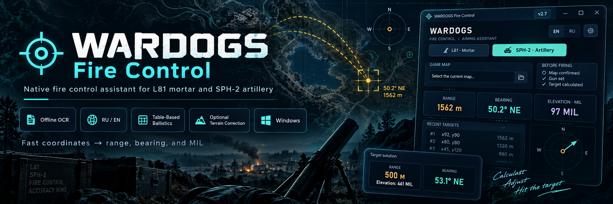
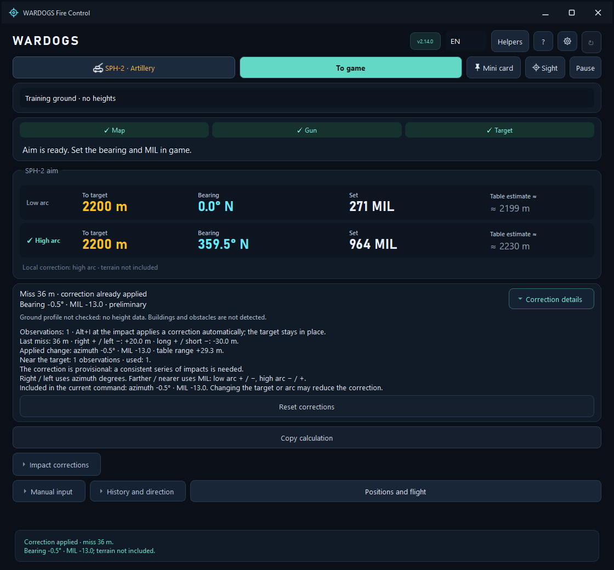
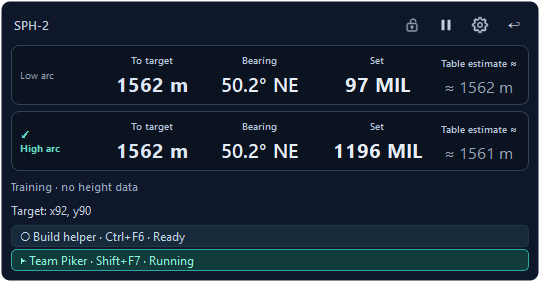
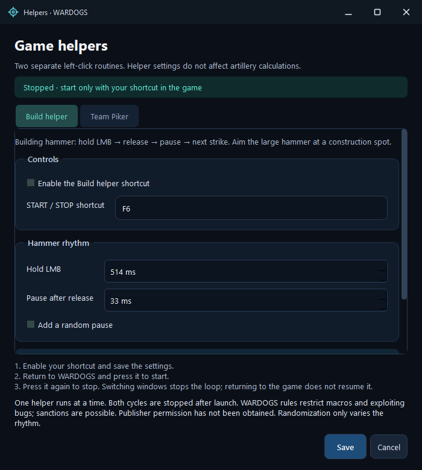
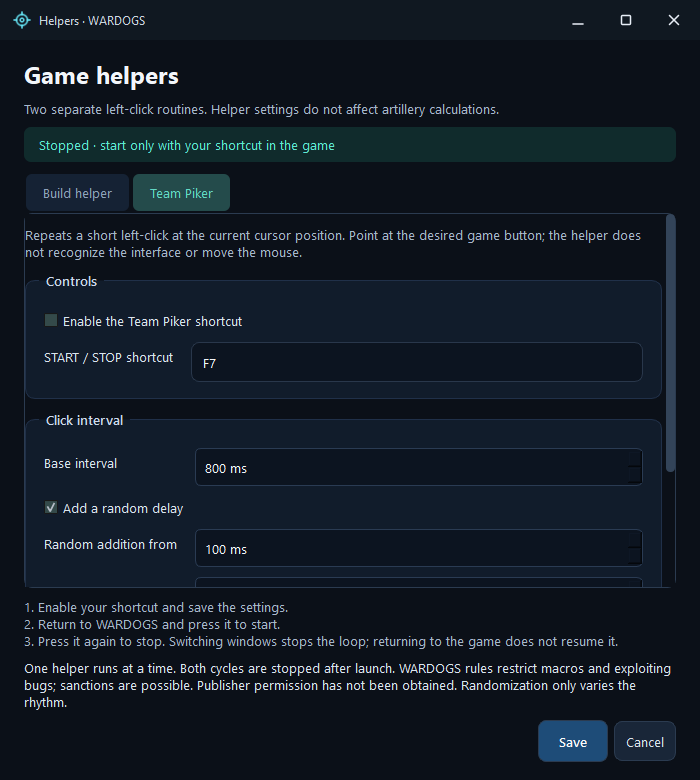
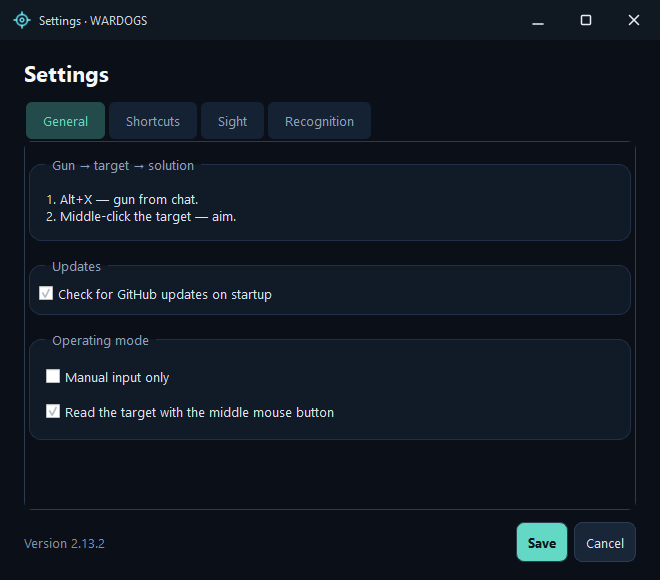
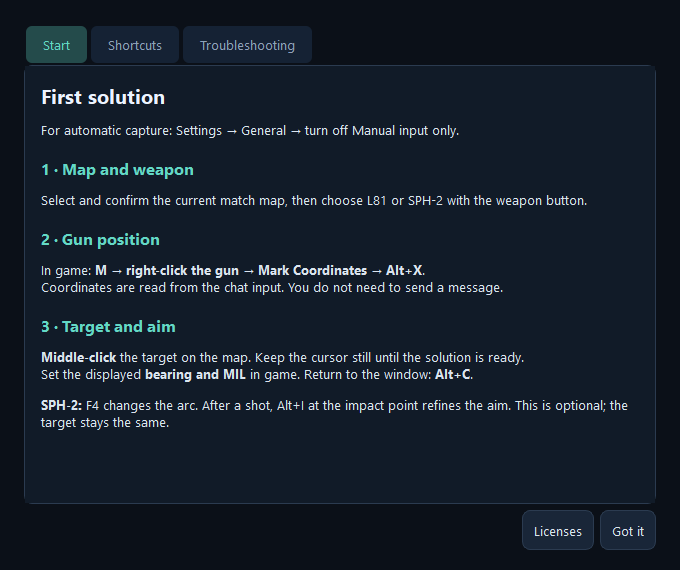

# WARDOGS Fire Control — mortar and artillery calculator

**A WARDOGS mortar and artillery calculator for L81 and SPH-2, on Windows 10/11 x64.** Calculate range, bearing and MIL from map coordinates, select an SPH-2 arc and optionally refine aim from an actual impact. Enter coordinates manually or capture them with local OCR; view the solution in the main window or an always-on-top mini card.

[Русский](README.md) · **English** · [Download for Windows](https://github.com/sany86russ/Wardogs-Fire-Control/releases/latest) · [Quick start](source/docs/QUICKSTART-EN.md) · [Report an issue](https://github.com/sany86russ/Wardogs-Fire-Control/issues)

**Version 2.14.0:** a separate **Build helper / Team Piker** window, persistent shortcuts and timing, and both helper statuses on L81 and SPH-2 mini cards. Helpers are enabled separately; their loops remain stopped after launch. [Full release EN/RU](docs/releases/v2.14.0.md) · [Full ChangeLog EN](source/docs/RELEASE-NOTES-EN.md) · [RU](source/docs/RELEASE-NOTES-RU.md).

A native screenshot of the actual app. Demonstration coordinates and statuses are synthetic; capture does not use the game or send game input. It does not validate hit accuracy.

> An unofficial community utility for the **WARDOGS game**, not affiliated with BULKHEAD and not intended for real weapons. Publisher approval for OCR, overlays and left-button automation has not been established. WARDOGS rules prohibit input-automation macros and exploiting bugs for advantage; account bans are possible. Randomization does not provide anti-cheat protection. Read the [game interaction rules and limits](source/docs/ANTICHEAT-EN.md) before use.

## Contents

- [Features](#features)
- [Download and update](#download-and-update)
- [First solution](#first-solution)
- [L81 and SPH-2: range and MIL](#l81-and-sph-2-range-and-mil)
- [SPH-2 ranging](#sph-2-ranging)
- [Keyboard shortcuts](#keyboard-shortcuts)
- [Interface and settings](#interface-and-settings)
- [Build helper and Team Piker](#build-helper-and-team-piker)
- [Maps and elevations](#maps-and-elevations)
- [OCR and coordinate review](#ocr-and-coordinate-review)
- [How the calculations work](#how-the-calculations-work)
- [Local data and privacy](#local-data-and-privacy)
- [RU and EN screenshots](#ru-and-en-screenshots)
- [Documentation and building](#documentation-and-building)
- [Limitations and feedback](#limitations-and-feedback)
- [Origins and licenses](#origins-and-licenses)
- [Support the author](#support)
- [Trouble connecting to WARDOGS](#trouble-connecting-to-wardogs)

## Features

| Feature | What the player gets |
|---|---|
| **L81 mortar** | Range, bearing and table-based MIL from gun and target coordinates |
| **SPH-2 artillery** | Available low and high arcs; one selected command to aim with |
| **Quick coordinate input** | **Alt+X** reads the gun from the active chat draft; **middle-click** reads a target beside the map cursor |
| **Local OCR** | Bundled model, CPU processing and review of uncertain coordinates |
| **Manual input** | Typed or pasted coordinates without game capture |
| **Mini card and auxiliary reticle** | Aim over other windows; size, opacity and locking; remembered card monitor and placement |
| **SPH-2 ranging** | Optional **Alt+I** correction, miss distance and the bearing/MIL change already applied |
| **SPH-2 terrain** | Elevation correction and an approximate ground-intersection assessment with a compatible local pack |
| **Positions and flight** | Target shifts, saved points, ground profiles and personal flight-time observations |
| **History** | Up to 12 session targets, 64 recent accepted points and 500 named records |
| **Capture pause** | **Ctrl+Alt+P** releases capture shortcuts, F4 and middle-click while retaining the solution |
| **Build helper / Team Piker** | A separate left-button helper window, configurable shortcuts and timing, persistent preferences and stop on window changes |
| **Russian and English** | Interface and help switching without a restart |
| **GitHub updates** | New-version checks and complete-package installation with SHA-256 verification |

The app calculates aiming values. The player sets bearing and MIL, fires and checks the result. No account, API key or cloud subscription is required.

## Download and update

**Requirements:** Windows 10/11 x64. Running the app does not require administrator privileges, Qt SDK, Visual Studio or Python.

1. Open the [latest stable release](https://github.com/sany86russ/Wardogs-Fire-Control/releases/latest).
2. Under **Assets**, download **WardogsFireControl-v2.14.0-win-x64.zip**.
3. **Extract the complete ZIP** to a separate folder.
4. Run **Start.cmd**, **Запустить.cmd** or **WarDogsDistanceCalculator.exe** from that folder.

Do not move only the EXE: the other DLLs and the `platforms` and `models` folders are required. GitHub's **Source code (zip/tar.gz)** archives are for development; the ready-to-run app is in the ZIP under Assets. Use **borderless windowed mode** for overlays; exclusive fullscreen needs separate validation.

### Verify the download

Compare the result with **SHA256SUMS.txt** from the same release:

~~~powershell
Get-FileHash .\WardogsFireControl-v2.14.0-win-x64.zip -Algorithm SHA256
~~~

With GitHub CLI installed, you can also verify the build's origin:

~~~powershell
gh attestation verify .\WardogsFireControl-v2.14.0-win-x64.zip --repo sany86russ/Wardogs-Fire-Control
~~~

### Update inside the app

Stable-release checks run in the background and can be disabled in settings; **Check for updates** remains available. The calculator continues working without an internet connection.

Installation starts after you click **Update**: the app downloads the complete ZIP, verifies its size, SHA-256 and file manifest, closes, replaces the package and restarts. You can cancel the download before installation. Settings, imported elevations, saved points and personal measurements in the Windows profile are preserved. The active solution and session history are not automatically restored after restarting.

To upgrade from **2.7.0 or earlier**, download the new ZIP manually once. Automatic installation requires a complete portable package and write access to its folder. If replacement fails, the updater restores the previous files; its backup and log remain in `.wardogs-update-…`. [Update and recovery details](docs/UPDATES-EN.md).

## First solution

### Quick in-game workflow

1. **Select and confirm the current map** in the calculator. This is required before calculation and after each launch.
2. Select **L81 · Mortar** or **SPH-2 · Artillery**.
3. In game: **M → right-click the gun → Mark Coordinates**. Wait for the complete X/Y pair in the chat input; no message needs to be sent.
4. Press **Alt+X**. A trustworthy position is accepted and the mini card opens.
5. Point at the target on the map and press the **middle mouse button**. Keep the cursor near the X/Y labels while reading is in progress.
6. Set the **bearing and final MIL** in game. For SPH-2, **F4** switches the selected available arc, identified by a check mark.
7. Fire. Optionally refine SPH-2: cursor over the actual impact → **Alt+I**, before changing the target or arc.
8. Middle-click again for the next target. **Alt+C** returns to the main window and keeps capture ready.

You do not need to select a custom OCR region for this workflow. Middle-click is passed through to the game and still places its marker. **Capture the gun coordinates again after moving it.** A map change clears current coordinates, session history and corrections; the map name is not read automatically.

**Ctrl+Alt+P** or **Pause / Resume** temporarily disables capture and hides the auxiliary reticle. Gun, target, corrections and history are retained; unfinished OCR is cancelled. Resuming does not take a screenshot by itself. [Complete workflow](source/docs/USAGE-EN.md).

### Manual workflow

Expand **Manual input** and type or paste coordinates:

~~~text
Gun:    x98.54, y110.33
Target: x101.72, y109.13
~~~

L81 displays approximately **340 m / 110.7° / 649 MIL**. Calculations use exact coordinates; displayed metres and MIL are rounded. Enable **Manual input only** in General settings to work without game capture.

## L81 and SPH-2: range and MIL

| Weapon / arc | Original samples | Horizontal table range | Game sight |
|---|---:|---:|---:|
| **L81** | 71 | 132–684 m | 850–150 MIL |
| **SPH-2, low** | 59 | 1181–2629 m | 20–600 MIL |
| **SPH-2, high** | 80 | 735–2629 m | 610–1400 MIL |

These are retained **community tables**, not verified data for the current WARDOGS patch. SPH-2 ranges describe level ground; arc availability with an elevation difference depends on the model and the permitted final sight setting. Unsupported solutions do not produce invented MIL values. **L81 has no elevation correction.**

**MIL is the game's aiming scale, not miles or metres.** Set the selected command's bearing and final MIL to fire. **To target** is horizontal map distance. **Table ≈** is the inverse range estimate of the current MIL; it may differ after elevation correction or ranging and is not a promise of agreement with the in-game RNG display.

The main window, mini card, auxiliary reticle, copying and Alt+I use one selected final command: **integer MIL and bearing rounded to 0.1°**. Analysis of another arc in additional tools is labelled as the baseline calculation.

## SPH-2 ranging

The first solution is available immediately; ranging shots are optional.

1. Fire using the displayed command for the selected arc.
2. Before changing the target, arc or gun, point at the **actual impact** on the map and press **Alt+I**.
3. The app refines the same target. **Ranging** shows the miss in metres, observation count and the bearing/MIL change **already included**.
4. Set the new final values. **Do not add the correction again.** Reset returns to the baseline solution.

Middle-clicking the impact creates a new target. Enter a manual impact through **Impact corrections** in the main window; reset and the complete report are available under **Correction details**.

A local correction applies to the same arc near the target and fades to zero at **50 m**. An impact is accepted only within **20% of horizontal range and 400 m simultaneously**; command compatibility and the permitted MIL are also checked. Incompatible observations are rejected, retaining the previous valid command. Repeated observations do not keep adding the same correction; history is limited to **256 impacts**.

After observations at at least three distinct targets from a stationary gun, a consistent **provisional bearing prediction** may apply to another target within the validated envelope. It is explicitly labelled, does not transfer a general MIL correction and does not guarantee a hit. Pause, weapon or manual arc changes withdraw prediction transfer while retaining local history.

The app does not observe firing, actual sight settings or chassis tilt. Alt+I refers to the command displayed when reading starts. If the chassis changes attitude at the same coordinates, **reset corrections manually**. [Ranging calculations and limits](source/docs/SPH2-VALIDATION-EN.md).

The card shows a synthetic solution and demonstration helper statuses. The strip displays actual assigned shortcuts; highlighting indicates a running loop, not a confirmed in-game hammer hit.

## Keyboard shortcuts

These are **defaults**. Occupied artillery shortcuts can use an available alternative shown by the app. Helper shortcuts are never replaced automatically; choose available combinations in their separate window.

| Action | Shortcut |
|---|---|
| Gun from the active chat draft | **Alt+X** |
| Target beside the map cursor | **Middle mouse button** |
| Impact for SPH-2 correction | **Alt+I** |
| Switch the selected SPH-2 arc | **F4** |
| Return to the main window | **Alt+C** |
| Pause / resume capture | **Ctrl+Alt+P** |
| Unlock the mini card | **Ctrl+Alt+Q** |
| Select a custom OCR region | **Alt+R** |
| Target from chat or a custom region | **Alt+T** |
| Temporarily select a line and read the target | **Alt+V** |
| Start / stop Build helper, after enabling its shortcut | **F6** |
| Start / stop Team Piker, after enabling its shortcut | **F7** |

Configure capture combinations under **Settings → Shortcuts**. If the complete supported set cannot be registered, the app displays an error and rolls registration back. Game capture requires the active WARDOGS window; global registration still reserves the combinations. Pause releases capture shortcuts, F4 and middle-click; return, unlock and resume controls remain available.

## Interface and settings

**RU / EN** in the header switches the interface and help without restarting. Russian is the default; the language is saved and translations are bundled.

| Section | Settings |
|---|---|
| **General** | Operating mode, middle-click and update checks |
| **Shortcuts** | Action combinations and effective replacements for conflicts |
| **Sight** | Auxiliary reticle size, opacity and alignment |
| **Recognition** | Marker delay, custom OCR region, engine for additional captures and coordinate pattern |

Drag the mini card to move it and drag its edges to resize it. It remembers the monitor, placement and separate L81/SPH-2 sizes. **Right-click the card** to control opacity, locking, the reticle and **Always on top**. A locked card passes clicks to the game; unlock it before using its buttons.

**Positions and flight** opens target shifts, recent and named points, ground profiles and personal flight-time observations. Shifting left/right/closer/farther by **10/25/50/100 m** changes target coordinates; it is separate from ranging. Restore saved points explicitly after confirming the map; old ranging corrections are not restored automatically.

## Build helper and Team Piker

**Helpers** in the main window and tray menu opens a separate **Build helper / Team Piker** tabbed window. These settings are separate from artillery calculations.

1. Select a tab and enable its shortcut. Both helpers are disabled in a fresh profile.
2. Assign a key: defaults are **F6** and **F7**. Set the timing and click **Save**.
3. Return to WARDOGS, equip the desired tool and aim at the object. Press and release the assigned shortcut to start the loop.
4. Press it again to stop. **Stop helpers**, application pause, opening settings, changing the active window and closing the app also stop it. Returning to the game does not resume clicks.

| Helper | Initial settings | Additional settings |
|---|---|---|
| **Build helper** | Hold LMB for **514 ms**, release for **33 ms**; **547 ms** cycle | Hold and pause; optional random **0–30 ms** pause addition, disabled by default |
| **Team Piker** | A **30 ms** click; **800 + 100–200 ms** between click starts, giving **900–1000 ms** | Base interval, randomization switch and addition range |

Shortcuts, timing and switches persist, but both loops remain stopped after a fresh app launch. Only one helper runs at a time. A read-only strip on both **L81 and SPH-2** mini cards shows each helper's state and actual assigned shortcut; the active mode is highlighted. Clicking the strip does not start input.

Helpers use ordinary `SendInput`, checking the exact foreground window and active desktop; they do not elevate privileges or conceal synthetic events. This does not establish publisher permission or protection from sanctions. The project owner selected **514/33**; hammer-release discussions do not establish universal timing. [Detailed setup and limits](source/docs/GAME-HELPERS-EN.md).

## Maps and elevations

- **Bakurani, Ozeti, Zestafona:** corresponding compatible local `.wdt` packs.
- **Training ground / unknown map:** an explicitly selected **no-height mode**, assuming equal gun and target elevations.
- **Terrain is not included in the public ZIP or repository** and is not downloaded automatically. Import only local data you have the necessary rights to use.
- Import checks SHA-256, map identity and geometry; reading checks block sizes and CRC. Missing coverage is not replaced with zero elevation.
- Packs reside in `%LOCALAPPDATA%\WardogsFireControl\terrain-packs` and survive application updates.

The grid spacing is **2 m**, stored height units are **0.1 m**, and bilinear interpolation is used between points. Data represents the ground surface; **buildings, bridges, roofs, trees and barrel height are not modelled**. A suitable training-ground dataset is unavailable; another map is not a substitute. [Terrain provenance and usage conditions](source/TERRAIN_DATA_NOTICE.md).

Import a compatible elevation pack separately

A compatible **terrain-packs.zip** is available in the [original Ricoz217 v1.4.0 release](https://github.com/Ricoz217/WarDogs_Distance_Calculator/releases/tag/v1.4.0): [download terrain-packs.zip](https://github.com/Ricoz217/WarDogs_Distance_Calculator/releases/download/v1.4.0/terrain-packs.zip). This is an external source of game data subject to separate [rights-holder conditions](source/TERRAIN_DATA_NOTICE.md); you do not need to install the original calculator.

1. Download and extract the archive yourself.
2. Locate **terrain-packs** containing **bakurani.wdt**, **ozeti.wdt** and **zestafona.wdt**.
3. In the calculator's main window, beside map selection, click **Connect local height data…**.
4. Select that folder. The app verifies the packs and saves them in the Windows profile.
5. Select and confirm the current match's map; enter the gun and target again after changing maps.

SHA-256 of the linked archive:

~~~text
c511df32f956e9171ac79bf939e955ea7f2851a4c39bdad6f924e46c989ede49
~~~

The link is pinned to the compatible **v1.4.0** pack; new or arbitrarily modified packs are not automatically considered compatible. After all three packs have been imported successfully, the import button is hidden.

## OCR and coordinate review

The main workflow uses **Paddle PP-OCRv6 Small through RapidOCR / ONNX Runtime on the CPU**. The model is bundled and recognition is local. Optional **Windows OCR** is for a custom region and needs a suitable English Windows OCR component; selecting it does not change the main Alt+X and middle-click paths.

**Alt+X** searches for a complete pair in the active chat draft, not old messages. In the quick workflow, targets and impacts use separate labelled **X/Y** fields in a bounded cursor neighbourhood inside the active game window. Automatic acceptance requires two trustworthy matching pairs from separate screenshots with consistent context; a request is limited to **four frames**. Version 2.14.0 has no periodic sight-HUD reading or continuous screen scanning.

Clipped, weak or competing pairs open review. The previous command is hidden until reading is resolved. Repeating capture can replace an uncertain result; choose or correct a pair in the main window and accept it explicitly. **Reject** restores the previous solution. A changed task prevents late OCR from replacing the new target.

If reading fails:

1. Gun: repeat **Mark Coordinates → Alt+X** with complete X/Y visible in the chat input.
2. Target: middle-click again with both labels visible, keeping the game window active during reading.
3. Backup: **M → right-click the target → Mark Coordinates → Alt+T**, with automatic search for additional captures enabled under **Settings → Recognition**. Otherwise Alt+T uses the saved custom region.
4. Use **Manual input**, a custom region or coordinate review to correct the values.

The default marker delay is **250 ms**, configurable from **0–2000 ms**; the first middle-click screenshot has a minimum delay of **80 ms**. This waits for the game's label, rather than describing total OCR duration. Support for every resolution, HUD layout and future game update is not promised. [Coordinate-reading research, RU](source/docs/COORDINATE-WORKFLOW-RESEARCH-RU.md).

## How the calculations work

One game-coordinate unit equals **100 m**. Horizontal range is the length of the gun-to-target segment multiplied by 100. Bearing runs clockwise from north: **0° north, 90° east, 180° south, 270° west**. MIL is linearly interpolated between adjacent table samples; fractional coordinates are retained until display rounding.

For SPH-2, compatible terrain provides an elevation difference. An approximate geometric model finds an equivalent range, then converts it back through the game's MIL table. MIL is not used directly as a physical barrel angle. Unreachable targets or unsupported sight settings produce explicit errors.

Automatic ground assessment checks the selected arc's **baseline model trajectory**. It distinguishes an estimated intersection, no detected intersection, unknown heights and incomplete coverage. It can suggest the other arc, but **does not switch automatically**. This is not a measured post-correction projectile path or a building check.

**Alt+I does not measure flight time:** elapsed time includes player reaction and map interaction. Time comes from matching personal observations or a separately enabled model; assumed speed and gravity are unverified and the model is disabled by default. [Formulas, sources and numerical limits](source/docs/CALCULATIONS-EN.md).

## Local data and privacy

Calculations, OCR and terrain processing run on your PC. The app does not read game memory or inject code. The player sets the sight. Separately enabled helpers send ordinary left-button events through Windows `SendInput`; they do not recognize the equipped tool or conceal synthetic input. Main game captures stay inside the active WARDOGS window; additional OCR reads a user-selected screen region. This does not establish anti-cheat approval. The clipboard is read when you click **Paste**, without background monitoring.

Profile: `%LOCALAPPDATA%\WardogsFireControl`.

| Data | File / folder |
|---|---|
| Settings and language | `settings.ini` |
| Additional-tool parameters | `planning.ini` |
| Recent accepted points | `recent-fire-missions.json` |
| Named records | `fire-missions.json` |
| Personal flight-time observations | `flight-profiles.json` |
| Imported elevations | `terrain-packs` |
| Logs | `logs` |

The profile survives updates; copy it while the app is closed to transfer it. A corrupt JSON store displays an error and is not automatically replaced with empty records. Confirm the map after launching; the active solution and old corrections are not automatically restored.

The current log is `logs\latest.log`, the previous one is `latest.previous.log`, and up to **32** older logs are kept in `latest.archive`. Each is limited to **4 MiB**: up to 128 MiB of archives and 8 MiB for current/previous files; a filesystem failure can leave an additional recovery file of up to 4 MiB. The archive does not retain history forever or delete unrelated files.

Logs contain OCR and calculation diagnostics and may include game coordinates and local paths; screenshots are not recorded in them. Review logs before public sharing. Internet access is used for updates and external links; coordinates, screenshots and terrain are not sent to GitHub.

## RU and EN screenshots

Native screenshots of the actual **2.14.0** application with synthetic calculations and helper states. Capture does not use the game or send real left-button input; images do not establish in-game accuracy or anti-cheat approval.

| Window | Русский | English |
|---|---|---|
| Main window | [Открыть](docs/screenshots/ru-main-2.14.0.png) | [Open](docs/screenshots/en-main-2.14.0.png) |
| Build helper | [Открыть](docs/screenshots/ru-helpers-build-2.14.0.png) | [Open](docs/screenshots/en-helpers-build-2.14.0.png) |
| Team Piker | [Открыть](docs/screenshots/ru-helpers-team-2.14.0.png) | [Open](docs/screenshots/en-helpers-team-2.14.0.png) |
| L81 mini card and helpers | [Открыть](docs/screenshots/ru-pinned-helpers-2.14.0.png) | [Open](docs/screenshots/en-pinned-helpers-2.14.0.png) |
| SPH-2 mini card and helpers | [Открыть](docs/screenshots/ru-vehicle-pinned-helpers-2.14.0.png) | [Open](docs/screenshots/en-vehicle-pinned-helpers-2.14.0.png) |

Historical 2.13.2 settings and help

These retained images document the previous version and do not show the new 2.14.0 features.

## Documentation and building

| Document | Contents |
|---|---|
| [Quick start EN](source/docs/QUICKSTART-EN.md) / [RU](source/docs/QUICKSTART-RU.md) | First solution, shortcuts, OCR and profile |
| [Workflow EN](source/docs/USAGE-EN.md) / [RU](source/docs/USAGE-RU.md) | Selected command, ranging, points and additional tools |
| [Calculations EN](source/docs/CALCULATIONS-EN.md) / [RU](source/docs/CALCULATIONS-RU.md) | Tables, formulas, elevations, sources and limits |
| [Architecture EN](source/docs/ARCHITECTURE-EN.md) / [RU](source/docs/ARCHITECTURE-RU.md) | Modules, threads and state |
| [Game interaction EN](source/docs/ANTICHEAT-EN.md) / [RU](source/docs/ANTICHEAT-RU.md) | Capture, system input and approval boundaries |
| [ChangeLog EN](source/docs/RELEASE-NOTES-EN.md) / [RU](source/docs/RELEASE-NOTES-RU.md) | Complete change history |
| [Build EN](docs/BUILD-EN.md) / [RU](docs/BUILD-RU.md) | Tools, verification, portable packaging and licenses |
| [Updates EN](docs/UPDATES-EN.md) / [RU](docs/UPDATES-RU.md) | Installation, retained data and recovery |
| [Localization](source/docs/LOCALIZATION.md) | Translation catalogs and checks |
| [Source code](source/) | App, OCR, model, tests and tools |

Stack: **C++20, Qt 6.8+, MSVC x64, CMake 3.24+, Ninja, ONNX Runtime, C++/WinRT and Zstandard**. Public builds use Qt **6.8.3**. Development requires a separate Visual Studio 2022 installation with **Desktop development with C++** and Qt MSVC x64. From the clone's root:

~~~powershell
$env:QT_ROOT = 'C:\Qt\6.8.3\msvc2022_64'
.\Build.ps1 -Configuration Release
~~~

This builds the project and runs CTest. `Build.ps1 -Package` prepares the portable package and also replaces the local `App` directory. See the [build guide](docs/BUILD-EN.md) for packaging without replacing `App`, archive contents and LGPL requirements.

[GitHub Actions](https://github.com/sany86russ/Wardogs-Fire-Control/actions) builds the Windows version and runs checks; release builds prepare the app ZIP, source code, corresponding Qt source and SHA-256. Consult Actions and the release for a particular run's result.

## Limitations and feedback

Wind, dispersion and target motion are not modelled. Elevations, flight time and ground assessment have the limits described above. Community tables may differ from the current game patch. **First-shot accuracy and any hit percentage, including 99% within 10 m, are not established or guaranteed.**

Automated checks cover calculations, OCR fixtures, rejection without state corruption, terrain, settings, input and RU/EN interface workflows. They do not replace in-game trials, every resolution/window-mode check or game developer approval.

When opening an [Issue](https://github.com/sany86russ/Wardogs-Fire-Control/issues), include:

- Calculator and Windows versions, language and display scale.
- Weapon, map, game resolution and window mode.
- Reproduction steps, expected behaviour and actual result.
- Coordinates, selected arc and a relevant log excerpt after reviewing its contents.

For OCR failures, a cropped X/Y screenshot without personal chat is useful. Do not attach passwords, keys, personal information or unrelated logs.

## Origins and licenses

WARDOGS Fire Control develops the MIT project **Rico217 / Ricoz217 — [WarDogs_Distance_Calculator](https://github.com/Ricoz217/WarDogs_Distance_Calculator)**. Its base is **v1.4.0**, commit `e1e14b2df5e59b6452a7aba105c36711b355d954`. Original attribution, license and [upstream documentation](source/docs/README-UPSTREAM.md) are preserved.

SoNiX's development includes portable launch, game-coordinate acquisition and review, local SPH-2 corrections, terrain handling, the mini card, auxiliary reticle and RU/EN localization. Exact sources of the investigated third-party EXE modification were unavailable; bit-for-bit identity with it is not claimed.

- **Application code:** [MIT](source/LICENSE).
- **L81 table:** community data from [apollyon-sys/wardogs-calculator](https://github.com/apollyon-sys/wardogs-calculator).
- **SPH-2 tables:** observations from [wardogs.t0ki.cn](https://wardogs.t0ki.cn/js/data.js), retained in the upstream base.
- **Qt:** dynamically linked, LGPL-3.0; **ONNX Runtime:** MIT; **PaddleOCR:** Apache-2.0; **Zstandard:** BSD-3-Clause. [Third-party notices](source/THIRD_PARTY_NOTICES.md).
- **Game and terrain:** remain the property of their respective rights holders and are not relicensed under MIT. [Terrain-data notice](source/TERRAIN_DATA_NOTICE.md).

WARDOGS and related marks belong to their respective owners. The app is not an official BULKHEAD product.

## Support the author

If WARDOGS Fire Control is useful to you, you can support SoNiX's development. Support is voluntary; the app is available without payment.

### Bitcoin (BTC)

**Network: Bitcoin**

~~~text
1GFcHvGPchDf6fgAqqtyZrEkFbVcrnWFgQ
~~~

### USDT

**Network: Tron (TRC20)**

~~~text
TEByALUzbYKWCYvyKPiAKrErs8ba6gc4Bo
~~~

Check the address and network before transferring. For USDT, use **Tron / TRC20**.

## Trouble connecting to WARDOGS

The author also maintains **[StabiLink Desktop](https://github.com/sany86russ/StabiLink-Desktop)**, another open-source project.

If your WARDOGS connection is unstable or the game is inaccessible from your network, explore StabiLink's features and instructions. It may help with some network restrictions; results depend on the cause, your provider and configuration. It is a separate program and is not required by the calculator.
