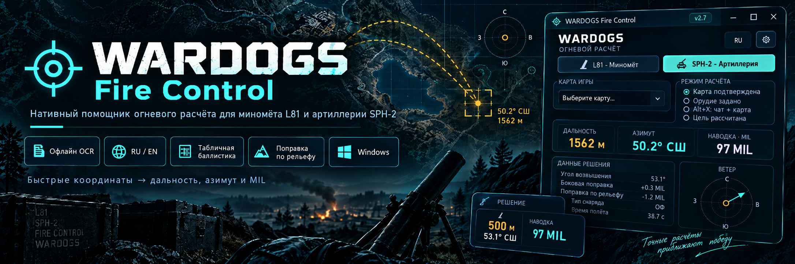
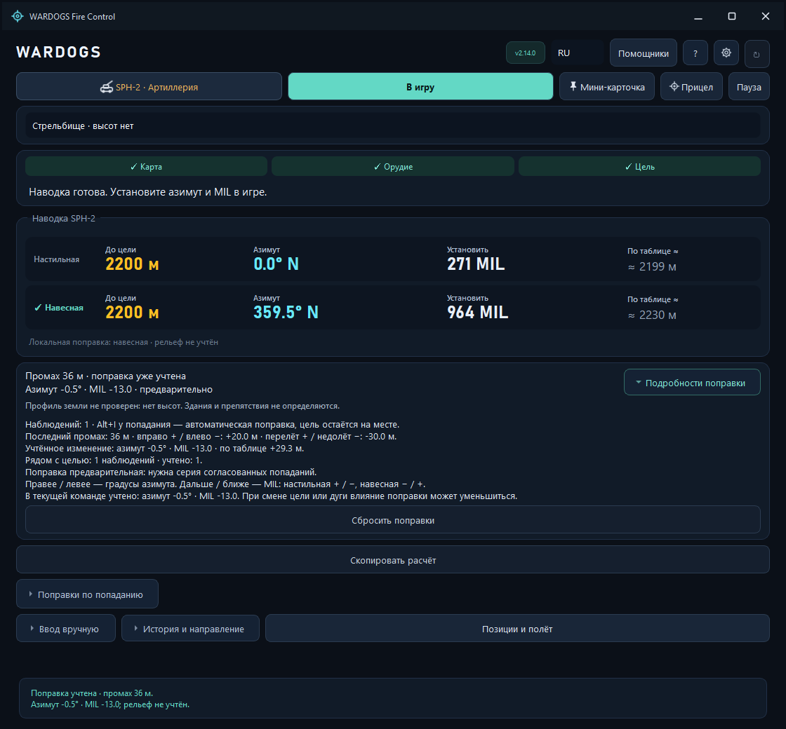
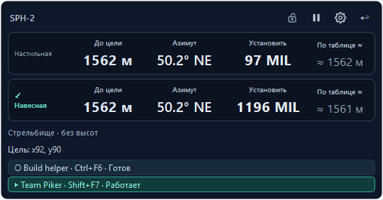
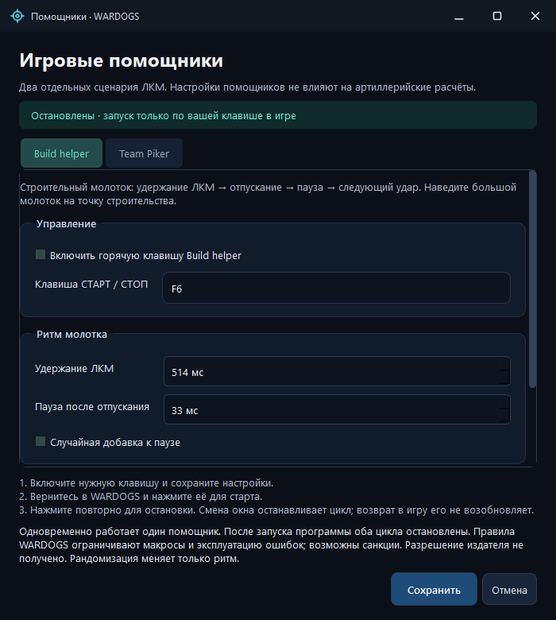
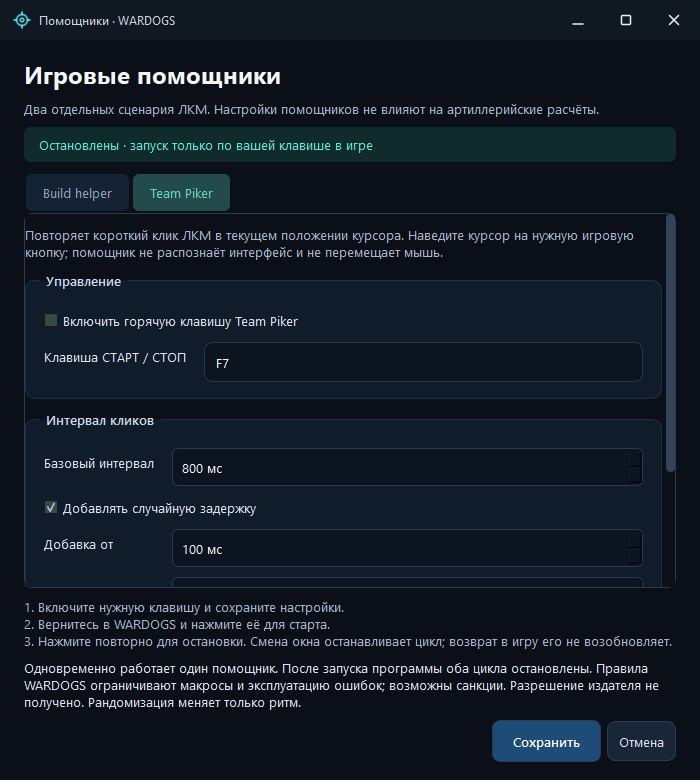
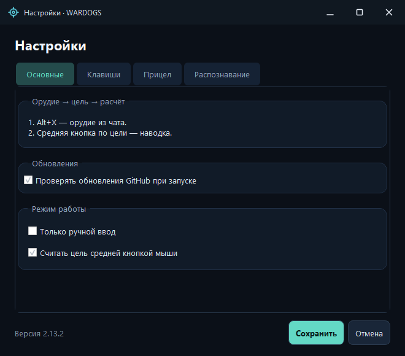
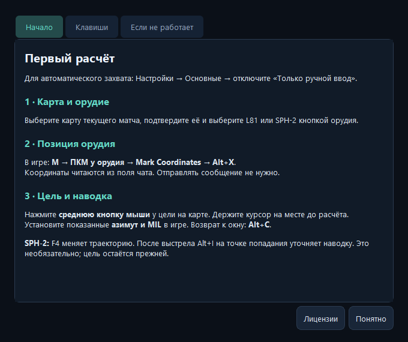

# WARDOGS Fire Control — калькулятор миномёта и артиллерии

**Калькулятор для миномёта L81 и артиллерии SPH-2 в игре WARDOGS, Windows 10/11 x64.** Получите дальность, азимут и MIL по координатам карты, выберите траекторию SPH-2 и при желании уточните наводку по фактическому попаданию. Координаты можно вводить вручную или читать локальным OCR; результат доступен в главном окне и мини-карточке поверх игры.

**Русский** · [English](README.en.md) · [Скачать для Windows](https://github.com/sany86russ/Wardogs-Fire-Control/releases/latest) · [Быстрый старт](source/docs/QUICKSTART-RU.md) · [Сообщить о проблеме](https://github.com/sany86russ/Wardogs-Fire-Control/issues)

**Версия 2.14.0:** отдельное окно **Build helper / Team Piker**, сохранение клавиш и интервалов, статусы обоих помощников в мини-карточках L81 и SPH-2. Помощники включаются отдельно; после запуска программы циклы остановлены. [Полный релиз RU/EN](docs/releases/v2.14.0.md) · [Полный ChangeLog RU](source/docs/RELEASE-NOTES-RU.md) · [EN](source/docs/RELEASE-NOTES-EN.md).

Нативный снимок настоящего приложения. Координаты и статусы для демонстрации синтетические; игра и отправка игрового ввода при съёмке не используются. Это не проверка попаданий.

> Неофициальная утилита сообщества для **игры WARDOGS**, не связанная с BULKHEAD и не предназначенная для реального оружия. Одобрение издателем OCR, наложений и автоматизации ЛКМ не подтверждено. Правила WARDOGS запрещают макросы автоматизации и эксплуатацию ошибок ради преимущества; возможна блокировка аккаунта. Рандомизация не защищает от античита. Перед использованием ознакомьтесь с [правилами взаимодействия с игрой](source/docs/ANTICHEAT-RU.md).

## Содержание

- [Возможности](#возможности)
- [Скачивание и обновление](#скачивание-и-обновление)
- [Первый расчёт](#первый-расчёт)
- [L81 и SPH-2: дальность и MIL](#l81-и-sph-2-дальность-и-mil)
- [Пристрелка SPH-2](#пристрелка-sph-2)
- [Горячие клавиши](#горячие-клавиши)
- [Интерфейс и настройки](#интерфейс-и-настройки)
- [Build helper и Team Piker](#build-helper-и-team-piker)
- [Карты и высоты](#карты-и-высоты)
- [OCR и проверка координат](#ocr-и-проверка-координат)
- [Как работают расчёты](#как-работают-расчёты)
- [Локальные данные и приватность](#локальные-данные-и-приватность)
- [Скриншоты RU и EN](#скриншоты-ru-и-en)
- [Документация и сборка](#документация-и-сборка)
- [Ограничения и обратная связь](#ограничения-и-обратная-связь)
- [Происхождение и лицензии](#происхождение-и-лицензии)
- [Поддержать автора](#support)
- [Проблемы с подключением к WARDOGS](#проблемы-с-подключением-к-wardogs)

## Возможности

| Возможность | Что получает игрок |
|---|---|
| **Миномёт L81** | Дальность, азимут и табличный MIL по координатам орудия и цели |
| **Артиллерия SPH-2** | Доступные низкую и высокую траектории; одну выбранную команду для наводки |
| **Быстрый ввод координат** | **Alt+X** — орудие из активного черновика чата; **средняя кнопка мыши** — цель у курсора карты |
| **Локальное распознавание OCR** | Модель в комплекте, работа на CPU, проверка сомнительных координат |
| **Ручной ввод** | Ввод и вставку координат без игровых захватов |
| **Мини-карточка и вспомогательный прицел** | Наводку поверх окон; размер, прозрачность и блокировку; сохранение монитора и положения карточки |
| **Пристрелка SPH-2** | Необязательную поправку по **Alt+I**, промах в метрах и уже учтённое изменение азимута/MIL |
| **Рельеф SPH-2** | Высотную поправку и приближённую оценку пересечения земли при наличии совместимого локального пакета |
| **Позиции и полёт** | Перенос цели, сохранённые точки, профиль земли и собственные замеры времени |
| **История** | До 12 целей сеанса, 64 последних принятых точек и 500 именованных записей |
| **Пауза захвата** | **Ctrl+Alt+P** освобождает клавиши захвата, F4 и среднюю кнопку, сохраняя расчёт |
| **Build helper / Team Piker** | Отдельное окно помощников ЛКМ, собственные клавиши и интервалы, сохранение настроек и остановку при смене окна |
| **Русский и английский** | Переключение интерфейса и справки без перезапуска |
| **Обновления GitHub** | Проверку новых версий и установку полного комплекта с проверкой SHA-256 |

Программа рассчитывает наводку. Игрок самостоятельно выставляет азимут и MIL, делает выстрел и проверяет результат. Аккаунт, API-ключ и облачная подписка не требуются.

## Скачивание и обновление

**Требования:** Windows 10/11 x64. Для запуска не нужны права администратора, Qt SDK, Visual Studio или Python.

1. Откройте [последний стабильный релиз](https://github.com/sany86russ/Wardogs-Fire-Control/releases/latest).
2. В **Assets** скачайте **WardogsFireControl-v2.14.0-win-x64.zip**.
3. **Распакуйте весь ZIP** в отдельную папку.
4. Запустите **Запустить.cmd**, **Start.cmd** или **WarDogsDistanceCalculator.exe** из этой папки.

Не переносите один EXE: необходимы остальные DLL, папки `platforms` и `models`. Архивы GitHub **Source code (zip/tar.gz)** предназначены для разработки; готовая программа находится в ZIP из Assets. Для окон поверх игры используйте **оконный режим без рамки**; работа в exclusive fullscreen требует отдельной проверки.

### Проверка скачанного файла

Сравните результат с **SHA256SUMS.txt** из того же релиза:

~~~powershell
Get-FileHash .\WardogsFireControl-v2.14.0-win-x64.zip -Algorithm SHA256
~~~

С установленным GitHub CLI можно дополнительно проверить происхождение сборки:

~~~powershell
gh attestation verify .\WardogsFireControl-v2.14.0-win-x64.zip --repo sany86russ/Wardogs-Fire-Control
~~~

### Обновление из программы

Проверка новых стабильных версий работает в фоне и отключается в настройках; кнопка **Проверить обновления** остаётся доступной. Без интернета калькулятор продолжает работать.

Установка начинается после нажатия **Обновить**: программа скачивает полный ZIP, проверяет размер, SHA-256 и комплект файлов, закрывается, заменяет комплект и запускается снова. Загрузку можно отменить до установки. Настройки, импортированные высоты, сохранённые точки и собственные замеры в профиле Windows сохраняются. Текущий расчёт и история сеанса после перезапуска не восстанавливаются автоматически.

Для перехода с **2.7.0 и более ранних версий** один раз скачайте новый ZIP вручную. Автоматической установке нужен полный переносимый комплект и право записи в его папку. При ошибке замены установщик восстанавливает прежние файлы; резервная копия и журнал остаются в `.wardogs-update-…`. [Подробности обновления и восстановления](docs/UPDATES-RU.md).

## Первый расчёт

### Быстрый игровой сценарий

1. **Выберите и подтвердите текущую карту** в калькуляторе. Это требуется перед расчётом и при каждом новом запуске.
2. Выберите **L81 · Миномёт** или **SPH-2 · Артиллерия**.
3. В игре: **M → ПКМ по орудию → Mark Coordinates / Отметить координаты**. Дождитесь полной пары X/Y в поле чата; отправлять сообщение не нужно.
4. Нажмите **Alt+X**. Уверенно прочитанная позиция принимается, открывается мини-карточка.
5. На карте наведите курсор на цель и нажмите **среднюю кнопку мыши**. Держите курсор возле подписей X/Y во время чтения.
6. Выставьте в игре **азимут и итоговый MIL**. Для SPH-2 **F4** меняет выбранную доступную траекторию, отмеченную галочкой.
7. Сделайте выстрел. При желании уточните SPH-2: курсор на фактическое попадание → **Alt+I**, до смены цели или траектории.
8. Для следующей цели снова нажмите среднюю кнопку. **Alt+C** возвращает главное окно, сохраняя готовность захвата.

Свою OCR-область для этого сценария выделять не нужно. Средний щелчок передаётся игре и продолжает ставить маркер. **После перемещения орудия задайте его координаты заново.** Смена карты очищает текущие координаты, историю сеанса и поправки; название карты автоматически не считывается.

**Ctrl+Alt+P** или кнопка **Пауза / Возобновить** временно отключает захваты и скрывает вспомогательный прицел. Орудие, цель, поправки и история сохраняются; незавершённый OCR отменяется. Возобновление само не делает снимок. [Полный рабочий цикл](source/docs/USAGE-RU.md).

### Ручной сценарий

Раскройте **Ввод вручную**, введите или вставьте координаты:

~~~text
Орудие: x98.54, y110.33
Цель:   x101.72, y109.13
~~~

L81 покажет примерно **340 м / 110,7° / 649 MIL**. Расчёт использует точные координаты; показанные метры и MIL округляются. Для работы без игровых захватов включите **Только ручной ввод** в основных настройках.

## L81 и SPH-2: дальность и MIL

| Орудие / траектория | Исходных точек | Горизонтальная дальность таблицы | Игровой прицел |
|---|---:|---:|---:|
| **L81** | 71 | 132–684 м | 850–150 MIL |
| **SPH-2, низкая** | 59 | 1181–2629 м | 20–600 MIL |
| **SPH-2, высокая** | 80 | 735–2629 м | 610–1400 MIL |

Это сохранённые **таблицы сообщества**, а не подтверждённые данные текущего патча WARDOGS. Диапазоны SPH-2 относятся к ровной поверхности; при перепаде высот доступность дуги зависит от модели и допустимого итогового прицела. За пределами поддерживаемого решения MIL не выдумывается. **L81 высотную поправку не применяет.**

**MIL — игровая шкала наведения, не мили и не метры.** Для выстрела используйте азимут и итоговый MIL выбранной команды. **До цели** — горизонтальные метры на карте. **По таблице ≈** — обратная оценка дальности текущего MIL; она может отличаться после высотной поправки или пристрелки и не обещает совпадения с RNG игрового прицела.

Главное окно, мини-карточка, вспомогательный прицел, копирование и Alt+I используют одну выбранную итоговую команду: **целые MIL и азимут до 0,1°**. Анализ другой дуги в дополнительных инструментах подписан как исходный расчёт.

## Пристрелка SPH-2

Первое решение доступно сразу; обязательных пробных выстрелов нет.

1. Выстрелите с показанной командой выбранной траектории.
2. До смены цели, дуги или орудия наведите курсор на **фактическое попадание** на карте и нажмите **Alt+I**.
3. Программа уточнит прежнюю цель. Блок **Пристрелка** покажет промах в метрах, число наблюдений и **уже учтённое** изменение азимута/MIL.
4. Выставьте новые итоговые числа. **Не прибавляйте поправку повторно.** Сброс возвращает исходный расчёт.

Средняя кнопка на попадании задаст новую цель. Ручное попадание вводится в главном окне через **Поправки по попаданию**; сброс и полный отчёт доступны в **Подробностях поправки**.

Локальная поправка относится к той же дуге возле цели и плавно исчезает на расстоянии **50 м**. Промах принимается только в пределах **20% горизонтальной дальности и 400 м одновременно**; также проверяется совместимость команды и допустимый MIL. Несовместимая запись отклоняется, прежняя допустимая наводка сохраняется. Повторные наблюдения не складывают одну и ту же поправку бесконечно; история ограничена **256 попаданиями**.

После наблюдений по минимум трём разным целям неподвижного орудия программа может применить согласованный **предварительный прогноз азимута** к следующей цели внутри проверенной области. Он явно подписан, не переносит общий MIL и не гарантирует попадание. Пауза, смена оружия или ручной выбор дуги отключает перенос прогноза, сохраняя местную историю.

Программа не наблюдает выстрел, фактическую установку прицела или наклон корпуса. Alt+I относится к команде, показанной при начале чтения. Если корпус изменил положение на прежней точке, **сбросьте поправки вручную**. [Расчёты и границы пристрелки](source/docs/SPH2-VALIDATION-RU.md).

На карточке — синтетический расчёт и демонстрационные статусы помощников. Полоса показывает реальные назначенные клавиши; подсветка означает работающий цикл, а не подтверждение игрового удара.

## Горячие клавиши

Значения **по умолчанию**. Для занятых артиллерийских сочетаний Windows приложение может подобрать свободный вариант; фактические сочетания видны в интерфейсе. Клавиши помощников не заменяются автоматически: выберите доступные сочетания в их отдельном окне.

| Действие | Клавиша |
|---|---|
| Орудие из активного черновика чата | **Alt+X** |
| Цель у курсора карты | **Средняя кнопка мыши** |
| Попадание для поправки SPH-2 | **Alt+I** |
| Переключить выбранную траекторию SPH-2 | **F4** |
| Вернуться в главное окно | **Alt+C** |
| Пауза / возобновление захвата | **Ctrl+Alt+P** |
| Разблокировать мини-карточку | **Ctrl+Alt+Q** |
| Выделить собственную область OCR | **Alt+R** |
| Цель из чата или своей области | **Alt+T** |
| Временно выделить строку и прочитать цель | **Alt+V** |
| Старт / стоп Build helper, после включения его клавиши | **F6** |
| Старт / стоп Team Piker, после включения его клавиши | **F7** |

Сочетания захвата меняются в **Настройки → Клавиши**. Если полный допустимый набор не зарегистрирован, программа показывает ошибку и откатывает регистрацию. Игровые захваты требуют активного окна WARDOGS; глобальная регистрация всё равно резервирует сочетания. Пауза освобождает клавиши захвата, F4 и среднюю кнопку; возврат, разблокировка и возобновление остаются доступны.

## Интерфейс и настройки

**RU / EN** в шапке переключает интерфейс и справку без перезапуска. Русский выбран по умолчанию; язык сохраняется, переводы встроены в приложение.

| Раздел | Что настраивается |
|---|---|
| **Основные** | Режим работы, средняя кнопка, проверка обновлений |
| **Клавиши** | Сочетания действий и фактические замены при конфликте |
| **Прицел** | Размер, прозрачность и выравнивание вспомогательного прицела |
| **Распознавание** | Задержка отметки, собственная OCR-область, движок дополнительных захватов и шаблон координат |

Мини-карточку можно перетаскивать и менять размер за края. Она запоминает монитор, положение и отдельные размеры L81/SPH-2. **ПКМ по карточке** открывает управление прозрачностью, блокировкой, прицелом и режимом **Поверх остальных окон**. Заблокированная карточка пропускает нажатия в игру; сначала разблокируйте её для работы с кнопками.

**Позиции и полёт** открывает перенос цели, последние и именованные точки, профиль земли и собственные замеры времени. Перенос левее/правее/ближе/дальше на **10/25/50/100 м** меняет координаты цели; это отдельное действие от пристрелки. Сохранённые точки восстанавливаются явно после подтверждения карты и не возвращают старую пристрелку автоматически.

## Build helper и Team Piker

Кнопка **Помощники** в главном окне и меню трея открывает отдельное окно с вкладками **Build helper / Team Piker**. Эти настройки отделены от расчётов артиллерии.

1. Выберите вкладку и включите её горячую клавишу. В новом профиле обе функции выключены.
2. Назначьте клавишу: по умолчанию **F6** и **F7**. Установите интервалы и нажмите **Сохранить**.
3. Вернитесь в WARDOGS, выберите нужный инструмент и наведитесь на объект. Нажмите и отпустите назначенную клавишу, чтобы начать цикл.
4. Повторное нажатие останавливает цикл. **Остановить помощников**, общая пауза, открытие настроек, смена активного окна и закрытие программы также останавливают его. Возврат в игру не возобновляет клики.

| Помощник | Исходные параметры | Дополнительная настройка |
|---|---|---|
| **Build helper** | ЛКМ удерживается **514 мс**, затем отпускается на **33 мс**; цикл **547 мс** | Удержание и пауза; случайная добавка к паузе **0–30 мс**, по умолчанию выключена |
| **Team Piker** | Короткий клик **30 мс**; **800 + 100–200 мс** между началами кликов, то есть **900–1000 мс** | Базовый интервал, включение случайности и диапазон добавки |

Назначения, интервалы и переключатели сохраняются, но после нового запуска программы оба цикла остановлены. Одновременно работает один помощник. В мини-карточках **L81 и SPH-2** полоса только для просмотра показывает состояние каждого помощника и фактическую назначенную клавишу; работающий режим подсвечивается. Нажатие на полосу не запускает клики.

Помощники используют стандартный `SendInput`, проверяют конкретное активное окно и текущий desktop; они не повышают права и не скрывают синтетические события. Это не разрешение издателя и не защита от санкций. Пресет молотка **514/33** выбран владельцем проекта; обсуждения отпускания кнопки после удара не подтверждают универсальность этих миллисекунд. [Подробная инструкция и границы](source/docs/GAME-HELPERS-RU.md).

## Карты и высоты

- **Bakurani, Ozeti, Zestafona:** соответствующие совместимые локальные `.wdt`-пакеты.
- **Стрельбище / неизвестная карта:** явно выбранный **режим без высот**, с равной высотой орудия и цели.
- **Рельеф не входит в публичный ZIP или репозиторий** и автоматически не скачивается. Подключайте только локальные данные, на использование которых у вас есть права.
- Импорт проверяет SHA-256, карту и геометрию; чтение проверяет размеры блоков и CRC. Высота вне покрытия не заменяется нулём.
- Пакеты хранятся в `%LOCALAPPDATA%\WardogsFireControl\terrain-packs` и сохраняются при обновлении программы.

Сетка имеет шаг **2 м**, единицы хранимых высот — **0,1 м**, между точками применяется билинейная интерполяция. Представлена поверхность земли; **здания, мосты, крыши, деревья и высота ствола не моделируются**. Подходящего набора для стрельбища нет; данные другой карты его не заменяют. [Происхождение и условия использования рельефа](source/TERRAIN_DATA_NOTICE.md).

Как подключить совместимый пакет высот отдельно

Совместимый **terrain-packs.zip** размещён в [исходном релизе Ricoz217 v1.4.0](https://github.com/Ricoz217/WarDogs_Distance_Calculator/releases/tag/v1.4.0): [скачать terrain-packs.zip](https://github.com/Ricoz217/WarDogs_Distance_Calculator/releases/download/v1.4.0/terrain-packs.zip). Это внешний источник игровых данных с отдельными [условиями правообладателей](source/TERRAIN_DATA_NOTICE.md); установка исходного калькулятора не требуется.

1. Скачайте и распакуйте архив самостоятельно.
2. Найдите папку **terrain-packs** с **bakurani.wdt**, **ozeti.wdt** и **zestafona.wdt**.
3. В главном окне калькулятора, рядом с выбором карты, нажмите **Подключить локальные высоты…**.
4. Выберите эту папку. Программа проверит и сохранит пакеты в профиле Windows.
5. Выберите и подтвердите карту текущего матча; после смены карты задайте орудие и цель заново.

SHA-256 указанного архива:

~~~text
c511df32f956e9171ac79bf939e955ea7f2851a4c39bdad6f924e46c989ede49
~~~

Ссылка закреплена за совместимым пакетом **v1.4.0**; новые или произвольно изменённые пакеты не считаются совместимыми автоматически. После успешного подключения всех трёх пакетов кнопка импорта скрывается.

## OCR и проверка координат

Основной сценарий использует **Paddle PP-OCRv6 Small через RapidOCR / ONNX Runtime на CPU**. Модель входит в комплект, распознавание выполняется локально. Дополнительный **Windows OCR** предназначен для своей области и требует подходящего английского OCR-компонента Windows; выбор не меняет основные пути Alt+X и средней кнопки.

**Alt+X** ищет полную пару в активном черновике чата, а не старые сообщения. В быстром сценарии цель и попадание читаются по отдельным подписанным **X/Y** в ограниченном окружении курсора внутри активного окна игры. Автопринятие требует двух согласованных уверенных пар на отдельных снимках при согласованном контексте; один запрос ограничен **четырьмя кадрами**. Периодического чтения прицела HUD и непрерывного сканирования экрана в 2.13.2 нет.

Обрезанные, слабые или конкурирующие пары открывают проверку. Пока чтение не разрешено, прежняя наводка скрыта. Повторный захват может заменить сомнительный результат; в главном окне можно выбрать или исправить пару и принять её явно. **Отклонить** возвращает прежний расчёт. Смена задачи не позволяет позднему OCR подменить новую цель.

Если чтение не удалось:

1. Орудие: повторите **Mark Coordinates → Alt+X**, показав полные X/Y в поле чата.
2. Цель: повторите средний щелчок, оставив обе подписи видимыми и не переключая окно во время чтения.
3. Резервный путь: **M → ПКМ по цели → Mark Coordinates → Alt+T** при включённом автопоиске дополнительных захватов в **Настройки → Распознавание**. Иначе Alt+T использует сохранённую свою область.
4. Используйте **Ввод вручную**, свою область или исправление в проверке координат.

Задержка отметки по умолчанию — **250 мс**, настройка — **0–2000 мс**; перед первым снимком средней кнопки действует минимум **80 мс**. Это ожидание подписи игры, а не длительность полного OCR. Поддержка всех разрешений, раскладок HUD и будущих обновлений игры не обещается. [Исследование чтения координат](source/docs/COORDINATE-WORKFLOW-RESEARCH-RU.md).

## Как работают расчёты

Одна единица координат игры равна **100 м**. Горизонтальная дальность — длина отрезка между орудием и целью, умноженная на 100. Азимут считается по часовой стрелке от севера: **0° — север, 90° — восток, 180° — юг, 270° — запад**. Между соседними строками таблицы MIL применяется линейная интерполяция; дробные координаты сохраняются до округления результата.

Для SPH-2 совместимый рельеф даёт перепад высот. Приближённая геометрическая модель выбирает эквивалентную дальность, затем переводит её обратно через игровую таблицу MIL. MIL не подставляется напрямую как физический угол ствола. Недостижимая цель или недопустимая установка дают явную ошибку.

Автоматическая оценка земли проверяет **исходную модельную дугу** выбранной траектории. Она различает предполагаемое пересечение, отсутствие обнаруженного пересечения, неизвестные высоты и неполное покрытие. Может предложить другую дугу, но **не переключает её автоматически**. Это не измеренная траектория снаряда после пристрелки и не проверка зданий.

**Alt+I не измеряет время полёта:** время до нажатия включает реакцию игрока и работу с картой. Время берётся из подходящих личных замеров или отдельно включённой модели; предполагаемые скорость и гравитация не подтверждены, модель выключена по умолчанию. [Формулы, источники и численные ограничения](source/docs/CALCULATIONS-RU.md).

## Локальные данные и приватность

Расчёты, OCR и рельеф обрабатываются на вашем ПК. Приложение не читает память игры и не внедряет код. Наводку выставляет игрок. Отдельно включённые помощники посылают обычные события ЛКМ через Windows `SendInput`; они не распознают выбранный инструмент и не скрывают синтетический ввод. Основные игровые захваты работают внутри активного окна WARDOGS; дополнительный OCR читает выбранную пользователем область экрана. Это не подтверждает одобрение античитом. Буфер обмена читается по нажатию **Вставить**, без фонового наблюдения.

Профиль: `%LOCALAPPDATA%\WardogsFireControl`.

| Данные | Файл / папка |
|---|---|
| Настройки и язык | `settings.ini` |
| Параметры дополнительных инструментов | `planning.ini` |
| Последние принятые точки | `recent-fire-missions.json` |
| Именованные записи | `fire-missions.json` |
| Собственные замеры времени | `flight-profiles.json` |
| Импортированные высоты | `terrain-packs` |
| Журналы | `logs` |

Профиль сохраняется при обновлениях; для переноса скопируйте его при закрытом приложении. При повреждённом JSON программа показывает ошибку и автоматически не заменяет записи пустым хранилищем. После запуска карту нужно подтвердить; текущий расчёт и старые поправки автоматически не восстанавливаются.

Текущий журнал — `logs\latest.log`, предыдущий — `latest.previous.log`, до **32** старых — в `latest.archive`. Каждый ограничен **4 МиБ**: до 128 МиБ архивов и 8 МиБ текущего/предыдущего файлов; при ошибке файловой системы возможен дополнительный файл восстановления до 4 МиБ. Архив не хранит историю бесконечно и не очищает посторонние файлы.

Журналы содержат диагностику OCR и расчётов, могут включать игровые координаты и локальные пути; скриншоты в них не записываются. Перед публичной отправкой проверьте содержимое. Интернет нужен для обновлений и внешних ссылок; координаты, снимки и рельеф на GitHub не отправляются.

## Скриншоты RU и EN

Нативные снимки настоящего приложения **2.14.0** с синтетическими расчётами и состояниями помощников. При съёмке игра не используется, реальный ввод ЛКМ не отправляется; изображения не подтверждают игровую точность или допуск античитом.

| Окно | Русский | English |
|---|---|---|
| Главное окно | [Открыть](docs/screenshots/ru-main-2.14.0.png) | [Open](docs/screenshots/en-main-2.14.0.png) |
| Build helper | [Открыть](docs/screenshots/ru-helpers-build-2.14.0.png) | [Open](docs/screenshots/en-helpers-build-2.14.0.png) |
| Team Piker | [Открыть](docs/screenshots/ru-helpers-team-2.14.0.png) | [Open](docs/screenshots/en-helpers-team-2.14.0.png) |
| Мини-карточка L81 и помощники | [Открыть](docs/screenshots/ru-pinned-helpers-2.14.0.png) | [Open](docs/screenshots/en-pinned-helpers-2.14.0.png) |
| Мини-карточка SPH-2 и помощники | [Открыть](docs/screenshots/ru-vehicle-pinned-helpers-2.14.0.png) | [Open](docs/screenshots/en-vehicle-pinned-helpers-2.14.0.png) |

Исторические настройки и справка 2.13.2

Эти изображения сохранены для истории и не показывают новые функции 2.14.0.

## Документация и сборка

| Документ | Содержание |
|---|---|
| [Быстрый старт RU](source/docs/QUICKSTART-RU.md) / [EN](source/docs/QUICKSTART-EN.md) | Первый расчёт, клавиши, OCR и профиль |
| [Рабочий цикл RU](source/docs/USAGE-RU.md) / [EN](source/docs/USAGE-EN.md) | Выбранная команда, пристрелка, точки и дополнительные инструменты |
| [Расчёты RU](source/docs/CALCULATIONS-RU.md) / [EN](source/docs/CALCULATIONS-EN.md) | Таблицы, формулы, высоты, источники и ограничения |
| [Архитектура RU](source/docs/ARCHITECTURE-RU.md) / [EN](source/docs/ARCHITECTURE-EN.md) | Модули, потоки и состояние |
| [Взаимодействие с игрой RU](source/docs/ANTICHEAT-RU.md) / [EN](source/docs/ANTICHEAT-EN.md) | Захваты, системный ввод и границы допустимости |
| [ChangeLog RU](source/docs/RELEASE-NOTES-RU.md) / [EN](source/docs/RELEASE-NOTES-EN.md) | Полная история изменений |
| [Сборка RU](docs/BUILD-RU.md) / [EN](docs/BUILD-EN.md) | Инструменты, проверки, переносимый комплект и лицензии |
| [Обновления RU](docs/UPDATES-RU.md) / [EN](docs/UPDATES-EN.md) | Установка, сохранение данных и восстановление |
| [Локализация](source/docs/LOCALIZATION.md) | Каталоги и проверка переводов |
| [Исходный код](source/) | Приложение, OCR, модель, тесты и инструменты |

Стек: **C++20, Qt 6.8+, MSVC x64, CMake 3.24+, Ninja, ONNX Runtime, C++/WinRT и Zstandard**. Публичная сборка использует Qt **6.8.3**. Для разработки отдельно установите Visual Studio 2022 с **Desktop development with C++** и Qt MSVC x64. Из корня клона:

~~~powershell
$env:QT_ROOT = 'C:\Qt\6.8.3\msvc2022_64'
.\Build.ps1 -Configuration Release
~~~

Команда собирает проект и запускает CTest. Для подготовки переносимого комплекта доступна `Build.ps1 -Package`; она также заменяет локальную папку `App`. Отдельный путь сборки без замены `App`, состав архивов и требования LGPL описаны в [инструкции сборки](docs/BUILD-RU.md).

[GitHub Actions](https://github.com/sany86russ/Wardogs-Fire-Control/actions) собирает Windows-версию и запускает проверки; релизная сборка готовит ZIP приложения, исходники, соответствующие исходники Qt и SHA-256. Результат конкретного запуска смотрите в Actions и релизе.

## Ограничения и обратная связь

Не моделируются ветер, разброс и движение цели. Высотная модель, время полёта и оценка земли имеют указанные выше ограничения. Таблицы сообщества могут расходиться с текущим патчем игры. **Точность первого выстрела и любой процент попаданий, включая 99% в пределах 10 м, не подтверждены и не гарантируются.**

Автоматические проверки охватывают расчёты, OCR на сохранённых примерах, отказ без повреждения состояния, высоты, настройки, ввод и RU/EN интерфейс. Они не заменяют игровые испытания, проверку каждого разрешения/режима окна или разрешение разработчика игры.

Для [Issue](https://github.com/sany86russ/Wardogs-Fire-Control/issues) укажите:

- Версию калькулятора и Windows, язык и масштаб экрана.
- Орудие, карту, разрешение игры и режим окна.
- Шаги воспроизведения, ожидаемый и фактический результат.
- Координаты, выбранную дугу и нужный фрагмент журнала после проверки содержимого.

Для ошибки OCR полезен обрезанный снимок X/Y без личной переписки. Не прикладывайте пароли, ключи, персональные данные или посторонние журналы.

## Происхождение и лицензии

WARDOGS Fire Control развивает MIT-проект **Rico217 / Ricoz217 — [WarDogs_Distance_Calculator](https://github.com/Ricoz217/WarDogs_Distance_Calculator)**. Основа — **v1.4.0**, commit `e1e14b2df5e59b6452a7aba105c36711b355d954`. Авторство, лицензия и [первоначальная документация](source/docs/README-UPSTREAM.md) сохранены.

Разработка SoNiX включает переносимый запуск, чтение и проверку игровых координат, локальные поправки SPH-2, работу с рельефом, мини-карточку, вспомогательный прицел и локализацию RU/EN. Точные исходники исследованной сторонней модификации EXE были недоступны; побитовая идентичность с ней не заявляется.

- **Код приложения:** [MIT](source/LICENSE).
- **Таблица L81:** данные сообщества [apollyon-sys/wardogs-calculator](https://github.com/apollyon-sys/wardogs-calculator).
- **Таблицы SPH-2:** наблюдения [wardogs.t0ki.cn](https://wardogs.t0ki.cn/js/data.js), сохранённые в upstream-основе.
- **Qt:** динамическая линковка, LGPL-3.0; **ONNX Runtime:** MIT; **PaddleOCR:** Apache-2.0; **Zstandard:** BSD-3-Clause. [Уведомления о сторонних компонентах](source/THIRD_PARTY_NOTICES.md).
- **Игра и рельеф:** принадлежат соответствующим правообладателям и не переводятся под MIT. [Уведомление о данных рельефа](source/TERRAIN_DATA_NOTICE.md).

WARDOGS и связанные товарные знаки принадлежат их владельцам. Программа не является официальным продуктом BULKHEAD.

## Поддержать автора

Если WARDOGS Fire Control оказался полезен, вы можете поддержать разработку SoNiX. Поддержка добровольная; приложение доступно без оплаты.

### Bitcoin (BTC)

**Сеть: Bitcoin**

~~~text
1GFcHvGPchDf6fgAqqtyZrEkFbVcrnWFgQ
~~~

### USDT

**Сеть: Tron (TRC20)**

~~~text
TEByALUzbYKWCYvyKPiAKrErs8ba6gc4Bo
~~~

Перед переводом проверьте адрес и сеть. Для USDT используйте **Tron / TRC20**.

## Проблемы с подключением к WARDOGS

У автора есть ещё один открытый проект — **[StabiLink Desktop](https://github.com/sany86russ/StabiLink-Desktop)**.

Если соединение с WARDOGS нестабильно или игра недоступна из вашей сети, посмотрите возможности StabiLink и его инструкции. Он может помочь с некоторыми сетевыми ограничениями; результат зависит от причины проблемы, провайдера и настроек. Это отдельная программа, для работы калькулятора она не нужна.
