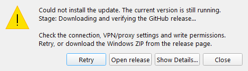

# WARDOGS Fire Control updates

[Русский](UPDATES-RU.md) · [README](../README.en.md)

The updater is available starting with **2.8.0**. It uses public stable releases of [sany86russ/Wardogs-Fire-Control](https://github.com/sany86russ/Wardogs-Fire-Control/releases/latest).

The current release is **2.17.0**: [changes EN/RU](releases/v2.17.0.md) · [complete portable package](https://github.com/sany86russ/Wardogs-Fire-Control/releases/download/v2.17.0/WardogsFireControl-v2.17.0-win-x64.zip). It updates SPH-2 arrow recognition, the initial low-arc baseline and updater resilience. Settings, maps, shortcuts and custom timing are preserved; helpers remain stopped after restarting.

## Using the updater

1. The app checks for a new release in the background at startup. You can disable startup checks in Settings.
2. Use **Check for updates** in the header to check manually.
3. When a banner appears, **What's new** opens the release page; **Later** hides the banner until the next check.
4. **Update** opens the download progress window. You can cancel before installation.
5. After the archive is verified, the app exits, updates the full package and restarts.

Finish your current calculation before updating. Coordinates, history and session corrections live in memory and are cleared on restart. Settings, logs and imported `.wdt` files under `%LOCALAPPDATA%\WardogsFireControl` are preserved.

## First upgrade from an older version

Versions **2.7.0 and earlier** cannot update themselves. Download `WardogsFireControl-v2.17.0-win-x64.zip` from Assets once and extract the **entire** archive into a separate folder. Launch the new package. Settings and imported heights are restored from your Windows profile. If personal maps live beside the old EXE in `terrain-packs/`, preserve and transfer those `.wdt` files separately.

**The first upgrade from 2.16.0 runs the installed 2.16.0 updater.** A new ZIP cannot repair an already running old client's network code before being downloaded. If the old version fails before the first progress percentage, use the full ZIP manually. The hardened 2.17.0 downloader and installer apply to subsequent updates from 2.17.0. Do not replace a single EXE or obtain `Update.ps1` from an unrelated site.

## Requirements and verification

- Windows 10/11 x64, HTTPS access to GitHub, Windows PowerShell 5.1 and write access to the application folder.
- A full portable package containing `package-manifest.json`, `Update.ps1`, DLLs and resources. Development builds must be updated manually.
- Only a newer stable `vX.Y.Z` version is accepted. Drafts and prereleases are skipped.
- The archive must have the exact name `WardogsFireControl-vX.Y.Z-win-x64.zip`, a correct URL in this repository and a SHA-256 digest in GitHub metadata.
- Downloads are bounded by the declared size. The updater verifies the complete ZIP SHA-256, file list, individual lengths and SHA-256 hashes. It also verifies the executable's Windows x64 format, product name and version.
- Archives with path traversal, duplicate paths, links, invalid manifests or damaged files are rejected before installed files are replaced.

TLS uses Windows certificate validation. The GitHub digest confirms integrity against release metadata; the updater does not independently verify GitHub attestations or publisher signatures. For manual downloads, you can additionally verify provenance using the command in the README.

Version checks do not send coordinates, images, settings or terrain. Calculations and local OCR remain available offline; manual checks report connection errors.

## Errors and recovery

Preparation uses a separate `.wardogs-update-…` directory inside the application folder. The archive, files and installation preparation are checked before the app closes. An external helper then waits for the app to exit and replaces only package files, keeping their previous versions. Unknown user files are preserved.

If replacement or process launch fails, the installer attempts to restore and restart the previous package. Backups and `error.log` remain in `.wardogs-update-…` for inspection and manual recovery. Rollback does not establish ongoing application health: a crash after the new process has launched successfully is not automatically diagnosed.

If the app will not start after an update, download a verified previous ZIP from Releases and extract it into a new folder. Settings and imported terrain remain in your Windows profile. When reporting an issue, provide the version, failed phase and diagnostics, checking the log for personal paths first.

### Failure before the first progress percentage

- If the updater cannot create its working directory, it needs write access to the application folder. Use the full package in a writable location. Network retries cannot fix a filesystem permission denial.
- If a connection has not been established, check access to `github.com` and the download host shown in diagnostics. Metadata comes from `api.github.com`; ZIP downloads may use `release-assets.githubusercontent.com`, `objects.githubusercontent.com` or `github-releases.githubusercontent.com`. Opening the GitHub website does not prove that every download host is reachable.
- Version 2.17.0 retries transient DNS, connection, proxy and selected HTTP errors up to three times. Bad archives, incorrect SHA-256, unapproved addresses, certificate errors and missing permissions are not bypassed.
- The error dialog can retry the update or open the release page for a manual download. Diagnostics distinguish working-directory creation, download, preparation and installer launch; network records contain the host, HTTP status and error code without signed-link query parameters.
- Domain blocks, untrusted certificates and organizational restrictions require a fix on the affected system. Keep TLS verification enabled and avoid unrelated “update repair” scripts.

### Installer changes in 2.17.0

An actual native diagnostic example of a failure before downloading. The host and code depend on the failure.

The installer retries transient file locks, writes receipts atomically and skips files already identical to the new payload. Full installed-package verification remains mandatory. After a successful installation, the downloaded ZIP and temporary extracted copy are removed; previous changed files needed for rollback and receipts remain. Failed installations retain recovery material. Temporary cleanup failures are reported separately and do not roll back an already running new version.

Release checks run on an isolated GitHub Windows runner: a real public-release download, forward updates with both the previously published helper and the new installer, paths containing spaces and Cyrillic text, preservation of user data and a real application restart. These checks cannot supply GitHub connectivity or write permissions on an individual computer.

Avoid running multiple copies from the same folder during an update. A short file lock may clear during a retry; a persistent lock from another copy or protective software produces diagnostics and a rollback attempt.
