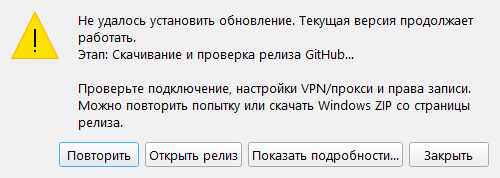

# Обновления WARDOGS Fire Control

[English](UPDATES-EN.md) · [README](../README.md)

Обновлятор доступен с версии **2.8.0**. Он использует публичные стабильные релизы [sany86russ/Wardogs-Fire-Control](https://github.com/sany86russ/Wardogs-Fire-Control/releases/latest).

Текущий выпуск — **2.17.0**: [изменения RU/EN](releases/v2.17.0.md) · [полный переносимый комплект](https://github.com/sany86russ/Wardogs-Fire-Control/releases/download/v2.17.0/WardogsFireControl-v2.17.0-win-x64.zip). Обновлены распознавание стрелок SPH-2, первичная настильная база и устойчивость обновлятора. Настройки, карты, назначенные клавиши и пользовательские интервалы сохраняются; после перезапуска помощники остановлены.

## Как пользоваться

1. При запуске программа проверяет новый релиз в фоне. Автопроверку можно выключить в настройках.
2. Для ручной проверки нажмите кнопку «Проверить обновления» в шапке.
3. Если появился баннер, «Что нового» открывает страницу релиза; «Позже» скрывает баннер до следующей проверки.
4. «Обновить» открывает загрузку с прогрессом. До установки загрузку можно отменить.
5. После проверки архива приложение закрывается, обновляет полный комплект и запускается снова.

Закончите текущий расчёт перед обновлением. Координаты, история и поправки текущего сеанса хранятся в памяти и после перезапуска очищаются. Настройки, журналы и импортированные `.wdt` в `%LOCALAPPDATA%\WardogsFireControl` сохраняются.

## Первый переход со старой версии

Версии **2.7.0 и раньше** не умеют обновляться сами. Один раз скачайте `WardogsFireControl-v2.17.0-win-x64.zip` из Assets и распакуйте **весь** архив в отдельную папку. Запускайте программу из нового комплекта. Настройки и импортированные высоты восстановятся из профиля Windows. Если личные карты хранятся рядом со старым EXE в `terrain-packs/`, сохраните и перенесите эти `.wdt` отдельно.

**Первый переход с 2.16.0 выполняет установленный обновлятор 2.16.0.** Новый ZIP не может исправить сетевой код уже запущенной старой версии до своего скачивания. Если старая версия выдаёт ошибку до первых процентов, используйте полный ZIP вручную. Усиленная загрузка и установщик 2.17.0 будут доступны для последующих обновлений из 2.17.0. Не заменяйте один EXE и не подменяйте `Update.ps1` файлом с другого сайта.

## Требования и проверка

- Windows 10/11 x64, HTTPS-доступ к GitHub, Windows PowerShell 5.1 и право записи в папку программы.
- Полный переносимый комплект с `package-manifest.json`, `Update.ps1`, DLL и ресурсами. Сборки из каталога разработки нужно обновлять вручную.
- Принимается только более новая стабильная версия `vX.Y.Z`. Черновики и предварительные релизы не устанавливаются.
- Архив должен иметь точное имя `WardogsFireControl-vX.Y.Z-win-x64.zip`, корректный адрес этого репозитория и SHA-256 в метаданных GitHub.
- Загрузка ограничена объявленным размером; проверяются SHA-256 всего ZIP, список файлов, длины и SHA-256 каждого файла. Проверяются также Windows x64, название продукта и версия EXE.
- ZIP с выходом за папку, дубликатами путей, ссылками, неподходящим манифестом или повреждёнными файлами отклоняется до замены установленной версии.

Используется TLS с проверкой сертификатов Windows. SHA-256 из GitHub подтверждает целостность относительно метаданных релиза; обновлятор не выполняет отдельную проверку GitHub attestations или подписи издателя. При ручном скачивании происхождение можно дополнительно проверить командой из README.

Проверка версии не отправляет координаты, изображения, настройки или рельеф. Без интернета расчёты и локальный OCR продолжают работать; ручная проверка сообщает об ошибке соединения.

## Ошибки и восстановление

Подготовка выполняется в отдельной папке `.wardogs-update-…` внутри папки программы. До закрытия приложения проверяются архив, файлы и возможность подготовки установки. Затем внешний помощник ждёт завершения приложения и заменяет только файлы пакета, сохраняя их предыдущие версии. Неизвестные файлы пользователя не удаляются.

При ошибке операции замены или запуска установщик пытается восстановить предыдущий комплект и запустить его. Резервные файлы и `error.log` остаются в `.wardogs-update-…`; это даёт возможность проверить и восстановить файлы вручную. Откат не является проверкой дальнейшей исправности программы: сбой после успешного запуска новой версии автоматически не диагностируется.

Если программа не запускается после обновления, проще всего скачать проверенный предыдущий ZIP из Releases и распаковать его в новую папку. Настройки и импортированный рельеф остаются в профиле Windows. При обращении в Issues приложите версию, этап сбоя и диагностику, предварительно проверив журнал на личные пути.

### Ошибка до первых процентов

- Если не удалось создать папку обновления, нужны права записи в папку программы. Используйте полный комплект в доступной для записи папке. Сетевая повторная попытка не исправляет запрет файловой системы.
- Если соединение ещё не установлено, проверяйте доступ к `github.com` и серверу загрузки, указанному в диагностике. Метаданные получаются с `api.github.com`, ZIP может передаваться через `release-assets.githubusercontent.com`, `objects.githubusercontent.com` или `github-releases.githubusercontent.com`. Доступ к странице GitHub не доказывает доступность всех этих адресов.
- В 2.17.0 временные ошибки DNS, соединения, прокси и выбранные HTTP-ошибки повторяются до трёх попыток. Повреждённый архив, неверный SHA-256, неподходящий адрес, ошибка сертификата или отсутствие прав не обходятся.
- В окне ошибки можно повторить обновление либо открыть страницу релиза для ручной загрузки. Диагностика различает создание папки, загрузку, подготовку и запуск установщика; сетевые записи содержат сервер, HTTP-код и код ошибки, без параметров подписанной ссылки.
- Блокировка домена, недоверенный сертификат или ограничения корпоративной системы требуют исправления доступа на этой системе. Не отключайте проверку TLS и не запускайте случайные скрипты «для исправления обновления».

### Что изменилось в установке 2.17.0

Нативный диагностический пример ошибки до загрузки. Конкретный сервер и код зависят от сбоя.

Установщик повторяет операции при временной блокировке файла, записывает квитанции атомарно и не переписывает файлы, уже совпадающие с новым пакетом. Проверка всего установленного комплекта остаётся обязательной. После успешной установки удаляются скачанный ZIP и распакованная временная копия; прежние изменённые файлы для отката и квитанции сохраняются. При неудаче материалы восстановления остаются на месте. Ошибка очистки временных файлов диагностируется отдельно и не откатывает уже запущенную новую версию.

Проверки выпуска выполняются на отдельном GitHub Windows runner: загрузка настоящего публичного релиза, переход старым опубликованным помощником и переход новым установщиком, пути с пробелами и кириллицей, сохранение данных и настоящий перезапуск приложения. Эти проверки не заменяют доступ к GitHub и права записи на конкретном компьютере.

Не запускайте несколько копий из одной папки во время обновления. Короткая блокировка файла может пройти после повторной попытки; постоянная блокировка другой копией или защитным ПО завершает установку с диагностикой и попыткой отката.
