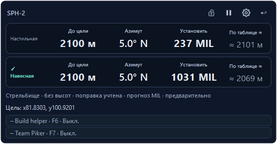
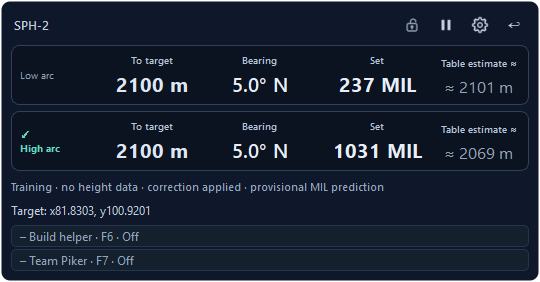

# WARDOGS Fire Control 2.15.0 — кандидат

Подготовка выпуска / Release preparation. Стабильная опубликованная версия остаётся [на странице releases/latest](https://github.com/sany86russ/Wardogs-Fire-Control/releases/latest).

## Русский

- Обычный Alt+I автоматически сохраняет принятое попадание и контекст расчёта в локальный ограниченный архив. Отдельные режимы замеров, новые клавиши и обязательные контрольные выстрелы не нужны.
- Согласованные наблюдения разных целей одной стоянки и дуги могут заранее уточнять MIL новой цели. Кандидат проверяется с исключением каждой цели и с учётом целой команды MIL; перенос ограничен совместно поддержанной областью дальности, направления и высоты.
- Сохранены локальные поправки, их приоритет, пределы прицела и сброс переноса при паузе/смене контекста. Архив не восстанавливает старую позу корпуса и не меняет общие таблицы автоматически.
- HUD, Windows Graphics Capture, подписка на выстрел по ЛКМ и мигающая цветная рамка не возвращаются. Пауза захвата оставляет Build helper и Team Piker работающими.
- Архив не содержит скриншотов и сырого OCR. Показанная команда явно остаётся неподтверждённой фактическим прицелом; физическая точность попаданий отдельно не установлена.

[Подробности обучения](../../source/docs/AUTOMATIC-LEARNING-RU.md).

Нативный рендер приложения с синтетическими координатами. Игра и чтение HUD не используются; изображение не является проверкой попаданий.

## English

- Normal Alt+I automatically archives accepted landings and calculation context locally. No separate measurement mode, new shortcut or mandatory control shot is required.
- Consistent independent targets from one emplacement/arc can provisionally improve a new target's MIL. Validation excludes each target and scores actual integer commands; transfer stays inside jointly supported range, direction and height.
- Local corrections retain priority. Sight limits and context/pause invalidation remain. Saved history never restores old body attitude or automatically modifies global firing tables.
- Background HUD reading, Windows Graphics Capture, left-button shot observation and flashing alignment frames stay disabled. Capture pause keeps Build helper and Team Piker available.
- The archive contains no screenshots or raw OCR. Displayed commands remain explicitly unverified actual sight settings; physical hit accuracy has not been established.

[Learning details](../../source/docs/AUTOMATIC-LEARNING-EN.md).

Native application rendering with synthetic coordinates. No game or HUD capture is used; this image does not validate impact accuracy.
