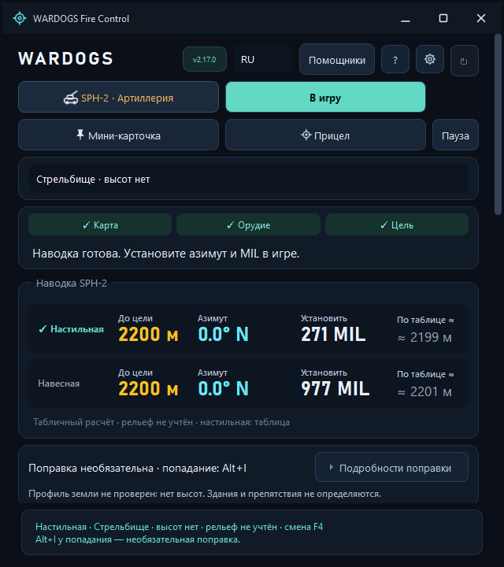
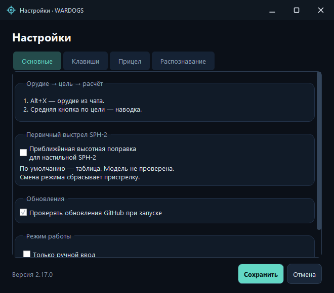
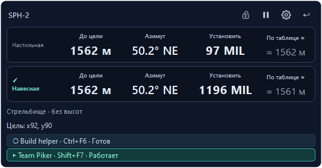
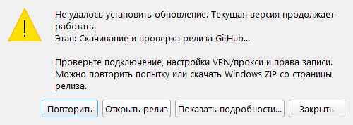
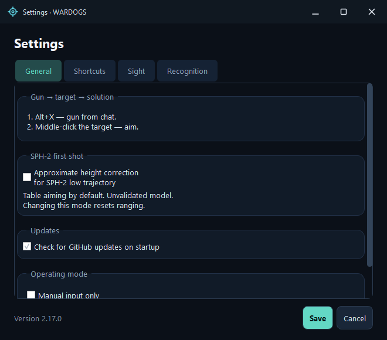
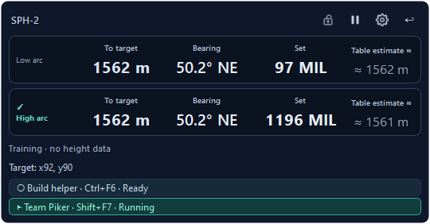
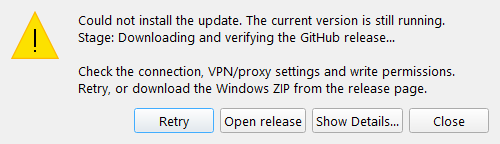

# WARDOGS Fire Control 2.17.0

9 ноября 2026 (МСК) / November 9, 2026 (MSK) · Windows 10/11 x64

**[Скачать программу / Download application](https://github.com/sany86russ/Wardogs-Fire-Control/releases/download/v2.17.0/WardogsFireControl-v2.17.0-win-x64.zip)** · [Полные исходники / Full source](https://github.com/sany86russ/Wardogs-Fire-Control/releases/download/v2.17.0/WardogsFireControl-v2.17.0-source.zip) · [Контрольные суммы / Checksums](https://github.com/sany86russ/Wardogs-Fire-Control/releases/download/v2.17.0/SHA256SUMS.txt)

## Русский

**2.17.0 обновляет распознавание активной перезарядки SPH-2 и начальную настильную наводку.** Стрелки читаются по заливке и восстанавливаемым контурам; найденная область повторно используется между перезарядками. Первый настильный расчёт теперь берётся из сохранённой таблицы без приближённой высотной поправки. Прежняя модель доступна отдельной настройкой.

### Первичный настильный расчёт SPH-2

- **Табличная база по умолчанию:** горизонтальная дальность переводится в существующую таблицу низкой траектории. Новая таблица, постоянная прибавка 50 MIL и неподтверждённые игровые коэффициенты не вводятся.
- **Настройки → Основные → Первичный выстрел SPH-2:** выключенная по умолчанию «Приближённая высотная поправка для настильной SPH-2» возвращает прежнюю модель. Её полное пояснение доступно во всплывающей подсказке. Сохранение другого режима сбрасывает текущую пристрелку.
- **Высоты сохраняются:** данные цели и попадания остаются в расчётном контексте, истории и ограничениях переноса поправки. Отключение высотного члена настильной команды не заменяет реальные высоты нулями.
- **Одна база для расчёта и попадания:** первичная команда, снимок предъявленной наводки и Alt+I используют один выбранный режим. Повторная отметка не прибавляет уже включённую поправку второй раз. Несовместимые поправки и кэш анализа очищаются при смене режима.
- **Навесная и L81 сохранены.** Приближённая дуга над рельефом по-прежнему использует реальные высоты и явно отделена от табличной настильной команды. Она не является восстановленным полётом снаряда или подтверждением попадания.
- Журнал и анализ сохранённых попаданий различают `sph2_empirical_low_v1` и прежний `sph2_retained_v1`. Старые записи без нового поля сохраняют прежнюю трактовку; разные базы не объединяются в одну группу анализа.

Владелец сообщил об успешной проверке предшествующей тестовой сборки. Это не независимая серия для всех карт, перепадов высот и положений орудия. Приближённая высотная модель и табличная база могут ошибаться; гарантированная точность первого выстрела и процент попаданий не заявляются.

### Распознавание и скорость перезарядки

- Восстановление **контуров и слитных силуэтов** дополняет чтение заливки стрелок. Обработаны тусклая серая заливка, мелкие варианты HUD и фрагменты, сливающиеся с окружением. Для поиска не нужны чёрный круг снаряда, верхнее кольцо или прямоугольная рамка.
- **Найденная область сохраняется между R:** после первого успешного обнаружения следующие кадры и перезарядки используют небольшую область. Изменение окна, геометрии или настройки области требует нового поиска; ошибка распознавания сбрасывает сохранённое положение.
- Ускорены построение цветовых масок и выделение компонентов. Это уменьшает работу на кадре без замены распознавания фиксированными координатами и без ослабления проверки формы.
- Сохранён простой цикл **четыре кадра → четыре группы по четыре клавиши**. В ожидании R и между отдельными клавишами кадры не снимаются; отслеживание анимаций и ожидание зелёных подтверждений не добавлены.
- **F8 → ожидание R**, задержка 500 мс после отпускания R, интервалы **50 / 90 / 750 мс**, Humanizer, ручная область и пользовательские горячие клавиши работают как прежде. Сохранённые интервалы не перезаписываются.
- Непрочитанная строка прекращает текущий цикл, а не угадывает направление. Потеря игрового фокуса или смена геометрии прерывает ввод и освобождает удерживаемую клавишу.

### Интерфейс и документация

- Главный расчёт и мини-карточка обозначают выбранную настильную базу; подробности модели доступны в подсказках.
- Настройка первого выстрела и её пояснение доступны на RU/EN без перезапуска. Короткие подписи не вытесняют подсказку рельефа; подробное описание сохранено во всплывающих подсказках.
- Обновлены README, быстрый старт, расчёты, пристрелка и анализ попаданий, архитектура, помощники и языковая справка. Новые нативные снимки показывают изменившиеся главное окно и настройки; неизменившиеся окна сохраняют явно подписанную предыдущую версию.

### Скачивание и диагностика обновления

- Временные ошибки DNS, подключения, прокси и таймаута, а также HTTP **408 / 429 / 500 / 502 / 503 / 504** получают до **трёх попыток** с паузами 500 и 1000 мс. Числовой `Retry-After` до 30 секунд соблюдается; больший срок показывает ошибку без преждевременного повторного запроса.
- При истёкшей подписанной CDN-ссылке и HTTP 403 повтор начинается с исходного адреса GitHub, чтобы получить свежий редирект. Каждая попытка сбрасывает неполный файл и состояние SHA-256; фрагменты разных загрузок не склеиваются.
- Для метаданных допускается до 30 секунд без полученных данных и до двух минут на всю операцию; для ZIP — 90 секунд без данных и до часа на загрузку. Медленное подключение не прерывается прежними короткими лимитами, но операция остаётся ограниченной по времени.
- При ошибке показан **конкретный этап**, доступны **Повторить** и **Открыть релиз**. Технические подробности содержат HTTP/сетевой код, адрес сервера и попытку, без секретной query-части подписанной ссылки; запись журнала сохраняется до очистки задачи.
- Ошибки TLS, авторизации, неверного SHA-256, превышения размера и перехода на посторонний сервер не обходятся повтором. Загрузка использует сеть, а не сохранённую копию ответа.
- Перед подготовкой и установкой проверяется размер и SHA-256 установленного `Update.ps1` по его собственному манифесту. Загруженный скрипт не подменяет доверенный установленный помощник. Подготовка ограничена десятью минутами, ожидание готовности — тремя; раннее завершение помощника немедленно показывает его код выхода.

### Установка обновления: меньше лишних операций и устойчивые квитанции

- Кратковременная блокировка файла другим процессом получает ограниченный повтор: до **12 попыток с паузой 250 мс** для ошибок совместного доступа/блокировки. Отказ в правах, неверный хеш и повреждённые данные не маскируются повтором.
- Подготовка, готовность к установке, журнал транзакции и итог установки записываются атомарно через временный файл и замену. Неоконченная запись не становится видимой как готовая JSON-квитанция.
- Файл, который уже совпадает с новым манифестом по размеру и SHA-256, не переписывается и не получает лишнюю резервную копию. Финальная проверка всего установленного payload сохраняется.
- Сохраняются строгая проверка версии, SHA-256, границ путей, личных настроек и `.wdt`, а также откат изменённых и удалённых файлов при ошибке транзакции.
- После успешной установки, проверки и запуска удаляются только подготовленные `staged/` и `download.zip` текущего обновления. Резервная копия изменённых файлов, доверенный помощник и квитанции остаются для восстановления; при ошибке или отмене внешнего установщика сохраняются его подготовленные данные. Отменённая загрузка удаляется. Сбой вспомогательной очистки записывает предупреждение и не откатывает уже запущенную новую версию.
- **Уже установленная 2.16.0 использует прежние механизмы скачивания и установки для перехода на 2.17.0.** Перечисленные улучшения применяются к следующим обновлениям из 2.17.0 и не могут задним числом изменить старое приложение. Если старое «Обновить» завершается ошибкой, скачайте полный Windows ZIP 2.17.0 в доступную для записи папку и выполните ручной переход по инструкции, сохранив свои данные.

### Обновление и данные

Из поддерживаемой установленной версии используйте **Проверить обновления → Обновить**. Обновление получает полный ZIP, проверяет SHA-256 и манифест, сохраняет профиль Windows и пользовательские карты. Если автоматическая подготовка не завершилась, не заменяйте один EXE: скачайте полный Windows ZIP из этого релиза и следуйте [инструкции обновления](https://github.com/sany86russ/Wardogs-Fire-Control/blob/v2.17.0/docs/UPDATES-RU.md).

Настройки, сохранённые точки, архив попаданий и пользовательские высоты не входят в заменяемый payload. Резервное копирование и откат штатного обновлятора не являются очисткой пользовательских карт или журналов. Свободное место, права записи и возможность завершить старый процесс по-прежнему необходимы.

### Проверка и ограничения

По просьбе владельца локальный набор перед выпуском повторно не запускался. GitHub Windows workflow собирает приложение, выполняет полный CTest, проверяет RU/EN на нативных масштабах, упаковывает комплект и проверяет обновление с настоящим перезапуском. Состояние конкретного прогона доступно во вкладке **Actions**.

Стрелки должны быть видимы и различимы; перекрытый или неоднозначный кадр может быть отвергнут. Обычный `SendInput` не обходит ограничения Windows, правила игры или античит. Одобрение издателя не подтверждено; Humanizer не гарантирует допустимость автоматизации. [Правила и ограничения](https://github.com/sany86russ/Wardogs-Fire-Control/blob/v2.17.0/source/docs/ANTICHEAT-RU.md).

### Изменившиеся окна

---

## English

**2.17.0 updates SPH-2 active-reload recognition and initial low-trajectory aiming.** Arrow fills and recovered contours supply directions, while the detected region is reused between reloads. Initial low-trajectory commands now use the retained table without the approximate height correction. The previous model remains separately selectable.

### Initial SPH-2 low-trajectory aiming

- **Table baseline by default:** horizontal range maps to the existing low-trajectory table. No replacement table, fixed 50 MIL addition or unverified game coefficients are introduced.
- **Settings → General → SPH-2 first shot:** the initially unchecked “Approximate height correction for SPH-2 low trajectory” restores the previous model. Its full explanation is available in a tooltip. Saving another mode resets current ranging corrections.
- **Actual heights are retained:** target and impact heights remain in calculation context, history and correction-transfer limits. Disabling the low-command height term does not replace terrain observations with zero.
- **One baseline for aiming and impacts:** the initial command, displayed-command snapshot and Alt+I use the same selected policy. Repeated impact recording does not add an already included correction twice. A mode change clears incompatible corrections and cached analysis.
- **High trajectory and L81 are preserved.** The approximate terrain arc still uses actual heights and is explicitly separate from the table-based low-trajectory command. It does not reconstruct a projectile's actual flight or certify a hit.
- Logs and offline impact analysis distinguish `sph2_empirical_low_v1` from the previous `sph2_retained_v1`. Older records without the field retain their legacy interpretation; unlike baselines are not pooled into one analysis group.

The owner reported a successful check of the preceding preview. This is not an independent series across all maps, height differences and gun orientations. Both the approximate height model and the table baseline can be wrong; guaranteed first-shot accuracy and a hit percentage are not claimed.

### Reload recognition and processing

- **Contour and joined-shape recovery** complements arrow-fill reading. It handles dim grey fills, small HUD variants and fragments touching surrounding pixels. Detection does not require a black shell circle, upper ring or rectangular outline.
- **The detected region is retained between R presses:** after the first successful detection, following snapshots and reloads use a small region. A changed window, geometry or region setting requires another search; a recognition error clears the retained position.
- Color-mask construction and component extraction are accelerated. This reduces per-frame work without replacing recognition with fixed coordinates or weakening shape checks.
- The simple **four snapshots → four batches of four keys** cycle is retained. Waiting for R and sending individual keys take no snapshots; animation tracking and waits for green acknowledgements are not added.
- **F8 → Waiting for R**, the 500 ms delay after R release, **50 / 90 / 750 ms** timing, Humanizer, manual regions and custom shortcuts behave as before. Saved intervals are not overwritten.
- An unreadable row ends the current cycle instead of guessing a direction. Lost game focus or changed geometry interrupts input and releases the owned key.

### Interface and documentation

- Main and mini-card captions identify the selected low-trajectory baseline; tooltips retain model details.
- First-shot settings and help switch between RU/EN without restarting. Compact captions do not displace terrain assistance; detailed explanations remain available in tooltips.
- Updated README, quick start, calculations, ranging and impact analysis, architecture, helpers and language guidance. New native screenshots cover the changed main window and settings; unchanged views retain their explicitly labelled earlier version.

### Update downloads and diagnostics

- Transient DNS, connection, proxy and timeout errors, plus HTTP **408 / 429 / 500 / 502 / 503 / 504**, get up to **three attempts**, separated by 500 and 1000 ms. A numeric `Retry-After` up to 30 seconds is respected; a longer value produces an error without an early retry.
- HTTP 403 from an expired signed CDN link restarts from the original GitHub URL to obtain a fresh redirect. Every attempt resets the partial file and SHA-256 state; fragments from different downloads are not combined.
- Metadata allows up to 30 seconds without incoming data and two minutes overall; ZIP downloads allow 90 seconds without data and one hour overall. Slow connections are no longer cut off by the previous short limits, while operations remain bounded.
- Errors show the **specific stage**, with **Retry** and **Open release** actions. Technical details include HTTP/network code, server host and attempt, without the secret query of a signed URL; session diagnostics are flushed before task cleanup.
- TLS, authorization, incorrect SHA-256, oversized responses and redirects to foreign hosts are not bypassed by retrying. Requests use the network rather than a cached response.
- Before preparation and installation, the installed `Update.ps1` is checked for size and SHA-256 against its own manifest. A downloaded script does not replace the trusted installed helper. Preparation is bounded to ten minutes and readiness to three; an early helper exit immediately reports its exit code.

### Installation: fewer rewrites and durable receipts

- Transient file sharing/lock errors get a bounded retry: up to **12 attempts, 250 ms apart**. Access-denied errors, mismatched hashes and invalid data are not hidden by retrying.
- Preparation, readiness, transaction journal and installation-result receipts are written atomically through a temporary file and replacement. An unfinished write is not exposed as a completed JSON receipt.
- A file that already matches the candidate manifest's size and SHA-256 is not rewritten or redundantly backed up. Final verification of the entire installed payload remains in place.
- Strict version, SHA-256, path, personal-settings and `.wdt` guards remain in force, as does rollback of changed and removed files after transaction failure.
- After successful installation, verification and launch, only the current update's prepared `staged/` and `download.zip` are removed. Changed-file backups, the trusted helper and receipts remain for recovery; preparation data is retained if the external installer fails or is cancelled. Cancelled downloads are removed. An auxiliary cleanup failure records a warning without rolling back an already running new version.
- **An already installed 2.16.0 uses its old download and installation code to reach 2.17.0.** These improvements apply to subsequent updates from 2.17.0 and cannot retroactively change the old application. If the old Update action fails, download the complete 2.17.0 Windows ZIP to a writable folder and follow the manual-update instructions while preserving personal data.

### Updating and data

From a supported installed version, use **Check for updates → Update**. The updater downloads the full ZIP, verifies SHA-256 and the manifest, and preserves the Windows profile and personal maps. If automatic preparation does not complete, do not replace only the EXE: download this release's full Windows ZIP and follow the [update instructions](https://github.com/sany86russ/Wardogs-Fire-Control/blob/v2.17.0/docs/UPDATES-EN.md).

Settings, saved points, the impact archive and personal terrain packs are outside the replaced payload. The updater's rollback backup is not a cleanup of personal maps or logs. Free space, write access and the ability to finish the old process remain necessary.

### Validation and limitations

At the owner's request, the local suite was not repeated before release. The GitHub Windows workflow builds the application, runs all CTest suites, checks RU/EN at native display scales, packages the application and tests updating with an actual restart. The specific run's result is available under **Actions**.

Arrows must remain visible and distinguishable; an occluded or ambiguous frame may be rejected. Ordinary `SendInput` does not bypass Windows restrictions, game rules or anti-cheat. Publisher approval is absent; Humanizer does not establish permission to automate. [Rules and limitations](https://github.com/sany86russ/Wardogs-Fire-Control/blob/v2.17.0/source/docs/ANTICHEAT-EN.md).

### Changed views

