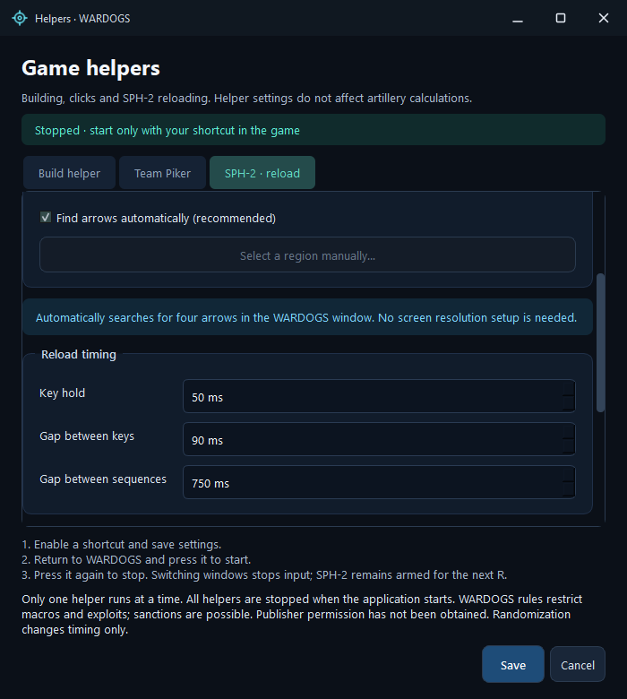
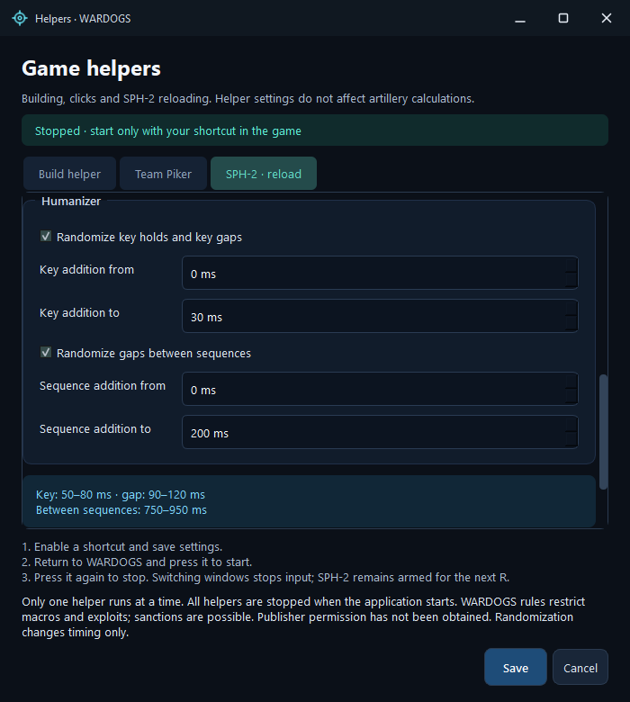
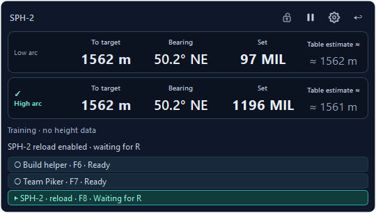

# Game helpers

Open **Helpers** from the main window or the application's tray menu. All three helpers have their own tab and settings in one window. They do not change artillery calculations.

**WARDOGS rules prohibit input-automation macros and exploiting bugs for advantage; account bans are possible. Publisher approval for these helpers is unconfirmed. Randomization does not provide anti-cheat protection.** [Official policy, checked November 8, 2026](https://www.wardogs.com/enforcement).

## First use

1. Enable the helper's hotkey on its tab. All helpers are disabled in a fresh profile.
2. Assign a key or combination and check the intervals. Defaults: **F6** for Build helper, **F7** for Team Piker and **F8** for SPH-2 reload.
3. Click **Save**. Change any occupied or duplicate shortcut; helper shortcuts are never replaced automatically. Win shortcuts and protected Windows commands are unavailable.
4. Return to WARDOGS, aim the cursor/sight at the desired object and press the assigned shortcut. Release it and its modifiers: a left-button helper starts its loop, while SPH-2 starts waiting for R. You do not need to hold the left mouse button yourself.
5. Press the same shortcut again to stop. **Stop helpers** is also available in the application and tray menu.

Only one helper runs at a time. Switching windows interrupts current input and releases the owned key/button. Build helper and Team Piker require a new start; armed SPH-2 keeps waiting for a fresh R in the game. Opening settings, Stop helpers and closing the application turn helpers off. Capture pause keeps the mouse helpers running and interrupts the current SPH-2 cycle; after resuming, armed SPH-2 waits for a new R. Game captures and middle-button reading remain disabled during capture pause, pending OCR is cancelled and the reticle is hidden. The last calculation is preserved.

## SPH-2 reload · v2.16.0

1. Enable the shortcut on **SPH-2 · reload** (default **F8**). Keep **Find arrows automatically** selected; no resolution or coordinates need configuring.
2. Press F8 once in the game: **Waiting for R** appears. After firing, press and release **R**. The cycle starts 500 ms later. Once finished, it waits for R again; F8 does not need enabling before every shot. The game's Active Reload actions must be bound to **↑ ↓ ← →**.
3. One fresh snapshot recognizes four arrow shapes in a row using their fill and contrasting boundaries. No circle is required. After detection, the small region is retained in memory for the remaining snapshots and subsequent reloads. A different window, resolution or search region requires discovery again; recognition failure discards the position for the next R. Directions are read afresh every time.
4. The four recognized keys are sent sequentially, followed by a pause before the next snapshot. One R uses **four snapshots and 16 key presses**. Hold, key gap and sequence gap are configurable; v2.16.0 defaults are **50 / 90 / 750 ms**. No snapshots are taken inside a batch and no green progress or animation is tracked. An unreadable row interrupts that cycle while leaving the helper armed for a fresh R.
5. Press F8 again or use **Stop helpers** to turn off both arming and current input. Window/focus changes interrupt the current cycle. R outside the game, with modifiers or while busy does not queue another run.

If the HUD cannot be found, choose **Select a region manually…**, select all four arrows with a small margin and save. Exactly one visible game window must be open. The region is stored relative to the game client and scales on the next run at a new resolution; each run pins the physical window geometry. The region must fit on one monitor.

The v2.16.0 **50 / 90 / 750 ms** defaults apply to a fresh profile and missing settings. Updating does not replace saved intervals; set the new values on the SPH-2 tab if required.

Humanizer has independent switches for additions to key holds/gaps and additions between sequences. Both default to off. Initial ranges are **0–30 ms** for each hold/key gap and **0–200 ms** between sequences; both bounds are editable. Additions are nonnegative, so enabling a preset does not reduce the configured delays. Preferences persist; armed F8 state does not persist across restarts.

The cycle deadline accounts for the maximum chosen delays plus a margin, with a 15-second minimum. Progress counts sent keys; game acceptance is not checked. No screenshots are taken while waiting for R.

Recognition is checked on supplied images, different backgrounds and scales. A very small arrow or one fused with surrounding pixels may be rejected; directions are never guessed from neighboring arrows. Support for every HUD variant remains unqualified. Images are processed locally.

## Shortcut assignment

In all three tabs, click **START / STOP key** and press the required key or side mouse button. Supported inputs include **Mouse4 / Mouse5**, numpad keys, punctuation, Esc, Tab, F12 and Ctrl/Alt/Shift combinations such as **Shift+Alt+F4** or **Ctrl+Mouse4**. The field shows the actual assignment.

Win shortcuts and protected Windows commands are unavailable. With SPH-2 enabled, plain R starts reloading and plain arrows are reload input; assign modifiers to use those keys as shortcuts. Hook-backed Mouse4/Mouse5/F12 bindings do not suppress their original action in the game or another application.

## Build helper

Base sequence: **hold the left button for 514 ms → release for 33 ms → repeat**. Hold and pause durations are configurable. A separate switch adds a random number of milliseconds from the configured range to the released pause; it is disabled by default with a 0–30 ms addition range. Hold duration is not randomized.

[Steam](https://steamcommunity.com/app/1867240/discussions/0/562541966849565845/) and [Reddit](https://www.reddit.com/r/WarDogs/comments/1wf8elq/is_hammer_animation_cancel_an_exploit/) discussions describe releasing the left button after the hammer contacts the object to start the next swing sooner. They support the community observation, but do not establish a universal **514/33 ms** preset. The project owner supplied this preset; our testing has not established its speed benefit in the current game version.

## Team Piker

A series of short left-button clicks without moving the cursor. The default interval is **800 ms + a random 100–200 ms addition**, giving **900–1000 ms between click starts**. This interval already includes the 30 ms button hold. Randomization can be disabled or its range changed.

The first click follows the start command and activation-key release; subsequent clicks follow the configured interval. All timings are nominal: Windows scheduling can delay an event.

## How input is sent

The helpers use documented Windows `SendInput`: one ordinary press and one release for the left mouse button or an arrow key. The application does not move the cursor, change game files or memory, or install a driver. Synthetic-input flags and Windows restrictions are not concealed or bypassed. [Microsoft SendInput](https://learn.microsoft.com/en-us/windows/win32/api/winuser/nf-winuser-sendinput), [event flags](https://learn.microsoft.com/en-us/windows/win32/api/winuser/ns-winuser-msllhookstruct).

Before each new press, the original foreground window is checked again for visibility and non-minimized state, and the current desktop must be receiving input. A desktop switch/lock or failed check stops new presses. An accepted press must still be released; an explicitly rejected press does not generate a spurious release. A Windows refusal stops the loop without elevating privileges or selecting another input method. These limits reduce unintended input but do not establish permission to use macros in the game. [Microsoft UOI_IO](https://learn.microsoft.com/en-us/windows/win32/api/winuser/nf-winuser-getuserobjectinformationw).

## Mini-card status strip

Both **L81 and SPH-2** mini cards have a separate strip showing helpers, their actual shortcuts and states:

| State | Meaning |
|---|---|
| **Off** | This helper's hotkey is disabled in settings |
| **Ready** | Its hotkey is enabled, but the loop is stopped |
| **Running** | The current loop is active and its row is highlighted |
| **Waiting for R** | SPH-2 is armed and waiting for the next reload |

The strip is read-only: clicking it does not start or switch a helper. Use the assigned shortcut for control and the **Helpers** window to edit preferences. A displayed state does not confirm an in-game hammer hit or anti-cheat acceptance.

Screenshots show the actual native application with synthetic calculations and states. Capture does not use the game or send real game input.

## Persistence and limits

Assigned shortcuts, hotkey enable choices, intervals and randomization switches are saved in the Windows profile: `%LOCALAPPDATA%\WardogsFireControl\settings.ini`. Restarting restores these preferences while **all helpers remain stopped** until an explicit shortcut press.

Starting requires a foreground window with matching WARDOGS caption/class metadata; this does not authenticate the game process. The loop is tied to one HWND and checks foreground every 10 ms and before a new press. This reduces the chance of clicking in another application but cannot eliminate a short window-switch race. If Windows refuses input, the loop stops with an error; restrictions are not bypassed. See [system interaction and game rules](ANTICHEAT-EN.md).
