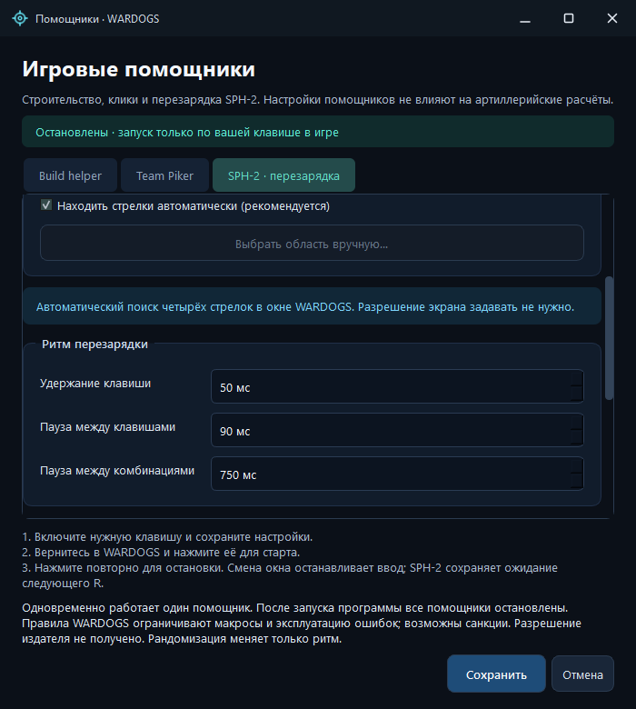
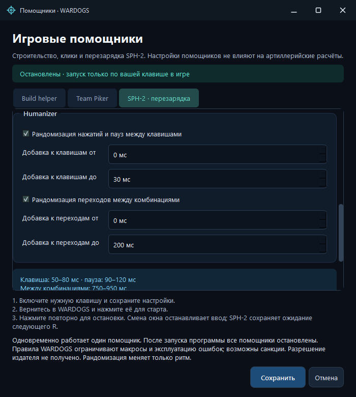
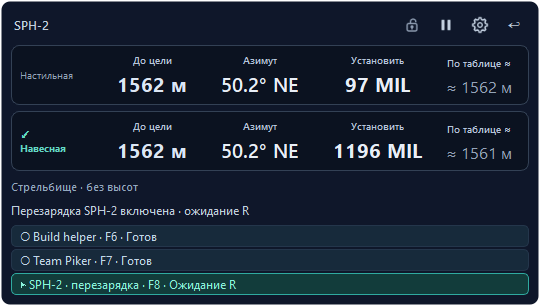

# Игровые помощники

Откройте **«Помощники»** в главном окне или меню значка программы в трее. В одном окне находятся три вкладки с собственными параметрами. Они не меняют артиллерийские расчёты.

**Правила WARDOGS запрещают макросы автоматизации ввода и эксплуатацию ошибок ради преимущества; возможна блокировка аккаунта. Одобрение этих помощников издателем не подтверждено. Рандомизация не защищает от античита.** [Официальная политика, проверена 8 ноября 2026 года](https://www.wardogs.com/enforcement).

## Первый запуск

1. На нужной вкладке включите горячую клавишу помощника. В новом профиле все помощники выключены.
2. Назначьте клавишу или сочетание и проверьте интервалы. По умолчанию: **F6** для Build helper, **F7** для Team Piker, **F8** для перезарядки SPH-2.
3. Нажмите **«Сохранить»**. Занятое или повторяющееся сочетание нужно изменить; программа не подменяет клавишу помощника автоматически. Системные сочетания с Win и защищённые команды Windows недоступны.
4. Вернитесь в WARDOGS, наведите курсор/прицел на нужный объект и нажмите назначенную клавишу. Отпустите её и модификаторы: помощник ЛКМ начнёт цикл, а SPH-2 включит ожидание R. Держать ЛКМ вручную не нужно.
5. Повторное нажатие той же клавиши останавливает цикл. Доступна и команда **«Остановить помощников»** в приложении и трее.

Одновременно работает один помощник. Смена окна прерывает текущий ввод и отпускает удерживаемую клавишу/ЛКМ. Build helper и Team Piker требуют нового запуска; включённый SPH-2 остаётся в ожидании нового R в игре. Открытие настроек, общий Стоп и закрытие программы выключают помощников. Пауза захвата оставляет Build helper и Team Piker работающими, а текущий цикл SPH-2 прерывает; после снятия паузы включённый SPH-2 ждёт нового R. Игровые захваты и средняя кнопка во время паузы отключены, незавершённый OCR отменён, прицел скрыт. Последний расчёт сохраняется, ручной ввод доступен.

## Перезарядка SPH-2 · v2.16.0

1. На вкладке **SPH-2 · перезарядка** включите горячую клавишу (по умолчанию **F8**). Оставьте **Находить стрелки автоматически**: разрешение и координаты указывать не требуется.
2. Один раз нажмите F8 в игре: появится **Ожидание R**. После выстрела нажмите и отпустите **R**. Через 500 мс помощник начнёт цикл. После завершения он снова ждёт R; повторно включать F8 перед каждым выстрелом не требуется. В настройках Active Reload игры должны быть назначены клавиши **↑ ↓ ← →**.
3. Один свежий кадр распознаёт четыре формы стрелок в строке по заливке и контрастным границам. Круг не требуется. После первого обнаружения небольшая область сохраняется в памяти для остальных кадров и следующих перезарядок. Другое окно, разрешение или область поиска требуют нового определения; после ошибки распознавания положение сбрасывается для следующего R. Направления каждый раз читаются заново.
4. По кадру последовательно нажимаются четыре клавиши, затем после паузы считывается следующая комбинация. Всего **четыре кадра и 16 нажатий** за один R. Настраиваются удержание клавиши, пауза между клавишами и пауза между комбинациями; значения по умолчанию в v2.16.0 — **50 / 90 / 750 мс**. Во время отправки четвёрки снимки не делаются, зелёный прогресс и анимация не отслеживаются. Нераспознанная строка прерывает только текущий цикл; помощник остаётся включённым и ждёт нового R.
5. Повторное F8 или **Остановить помощников** выключает режим ожидания и текущий ввод. Смена окна/геометрии прерывает текущий цикл; R вне игры, с модификаторами или во время занятого цикла не ставится в очередь.

Если вид HUD не распознан, выберите **Выбрать область вручную…**, обведите все четыре стрелки с небольшим отступом и сохраните. Игра должна быть открыта в единственном видимом окне. Область хранится в долях клиентской части окна и масштабируется при следующем запуске на новом разрешении; текущий запуск привязан к неизменной геометрии. Область должна целиком помещаться на одном мониторе.

Исходные интервалы v2.16.0 **50 / 90 / 750 мс** применяются к новому профилю и отсутствующим параметрам. Обновление не перезаписывает уже сохранённые интервалы: при необходимости выставьте эти значения на вкладке SPH-2.

Для Humanizer есть два независимых переключателя: случайная добавка к удержанию/паузам клавиш и случайная добавка между комбинациями. По умолчанию оба выключены. Начальные диапазоны — **0–30 мс** для каждого удержания и промежутка между клавишами, **0–200 мс** для перехода между комбинациями; минимум и максимум редактируются. Прибавки неотрицательные, поэтому включение пресета не уменьшает настроенные задержки. Настройки сохраняются, включённое состояние F8 после перезапуска не восстанавливается.

Лимит цикла рассчитывается по максимальным выбранным задержкам с запасом, минимум — 15 секунд. Счётчик сообщает об отправленных клавишах; принятие игрой не проверяется. В ожидании R снимки экрана не делаются.

Распознавание проверено на предоставленных кадрах, разных фонах и масштабах. Очень мелкая или слившаяся с окружением стрелка может быть отвергнута; направление по соседним стрелкам не угадывается. Поддержка всех вариантов HUD не подтверждена. Изображения обрабатываются локально.

## Назначение клавиш

Во всех трёх вкладках щёлкните поле **Клавиша СТАРТ / СТОП** и нажмите нужную клавишу либо боковую кнопку мыши. Поддерживаются **Mouse4 / Mouse5**, клавиши цифрового блока, пунктуация, Esc, Tab, F12 и сочетания с Ctrl/Alt/Shift, например **Shift+Alt+F4** или **Ctrl+Mouse4**. Поле показывает фактическое назначение.

Системные Win-сочетания и защищённые команды Windows недоступны. При включённом SPH-2 обычная R занята запуском перезарядки, а обычные стрелки — её вводом; для этих клавиш назначайте сочетание с модификатором. Hook-назначения Mouse4/Mouse5/F12 не подавляют исходное действие кнопки в игре или другой программе.

## Build helper

Базовый сценарий: **удерживать ЛКМ 514 мс → отпустить на 33 мс → повторить**. Настраиваются удержание и пауза. Отдельный переключатель добавляет к паузе случайное число миллисекунд из заданного диапазона; по умолчанию эта опция выключена, диапазон добавки — 0–30 мс. Удержание случайно не меняется.

Обсуждения в [Steam](https://steamcommunity.com/app/1867240/discussions/0/562541966849565845/) и [Reddit](https://www.reddit.com/r/WarDogs/comments/1wf8elq/is_hammer_animation_cancel_an_exploit/) описывают отпускание ЛКМ после контакта молотка с объектом, чтобы раньше начать следующий замах. Они подтверждают наблюдение пользователей, но не универсальный пресет **514/33 мс**. Этот пресет задан владельцем проекта; его ускорение в текущей версии игры не подтверждено нашими испытаниями.

## Team Piker

Серия коротких кликов ЛКМ без перемещения курсора. По умолчанию интервал — **800 мс + случайная добавка 100–200 мс**, то есть **900–1000 мс между началами кликов**. В этот интервал уже входит удержание кнопки 30 мс. Случайность можно выключить или изменить её диапазон.

Первый клик выполняется после команды запуска и отпускания клавиши; затем повторяется с настроенным интервалом. Все интервалы номинальные: планировщик Windows может задержать событие.

## Как отправляется ввод

Используется документированный Windows `SendInput`: одно обычное событие нажатия и одно отпускание для ЛКМ либо клавиши стрелки. Программа не перемещает курсор, не меняет игровые файлы или память и не устанавливает драйвер. Метки синтетического ввода и системные ограничения Windows не скрываются и не обходятся. [Microsoft SendInput](https://learn.microsoft.com/en-us/windows/win32/api/winuser/nf-winuser-sendinput), [метки событий](https://learn.microsoft.com/en-us/windows/win32/api/winuser/ns-winuser-msllhookstruct).

Перед новым нажатием повторно проверяются исходное активное окно, его видимость и отсутствие сворачивания, а также получение ввода текущим рабочим столом. При блокировке/смене рабочего стола или ошибке проверки новые нажатия прекращаются. Отпускание уже принятого нажатия остаётся обязательным; при явно отклонённом нажатии лишнее отпускание не отправляется. Отказ Windows завершает цикл, без повышения прав и альтернативного способа ввода. Эти ограничения уменьшают риск ошибочного ввода, но не подтверждают разрешение макросов игрой. [Microsoft UOI_IO](https://learn.microsoft.com/en-us/windows/win32/api/winuser/nf-winuser-getuserobjectinformationw).

## Состояния на мини-карточке

Мини-карточки **L81 и SPH-2** показывают отдельную полосу с помощниками, их фактическими клавишами и состояниями:

| Состояние | Что означает |
|---|---|
| **Выкл.** | Горячая клавиша этого помощника выключена в настройках |
| **Готов** | Горячая клавиша включена, цикл остановлен |
| **Работает** | Выполняется текущий цикл; строка подсвечивается |
| **Ожидание R** | SPH-2 включён и ждёт следующей перезарядки |

Полоса предназначена только для просмотра: нажатие не запускает и не переключает помощник. Управление остаётся на назначенной клавише, изменение параметров — в окне **Помощники**. Статус не подтверждает принятие удара игрой и не является проверкой античита.

Снимки показывают настоящее нативное приложение с синтетическими расчётами и состояниями. Съёмка не использует игру и не отправляет реальный игровой ввод.

## Сохранение и границы

Назначенные клавиши, включение горячих клавиш, интервалы и переключатели случайности сохраняются в профиле Windows: `%LOCALAPPDATA%\WardogsFireControl\settings.ini`. После перезапуска параметры восстанавливаются, а **все помощники остаются остановлены** до явного нажатия клавиши.

Запуск допускается при активном окне с подходящими заголовком и классом WARDOGS; это проверка метаданных окна, а не удостоверение игрового процесса. Цикл привязан к конкретному HWND, проверяет foreground каждые 10 мс и перед новым нажатием. Это уменьшает вероятность клика в другом приложении, но не исключает краткую гонку при переключении окон. При отказе Windows принять ввод цикл останавливается с ошибкой; обход ограничений не используется. Подробности — [системное взаимодействие и правила](ANTICHEAT-RU.md).
